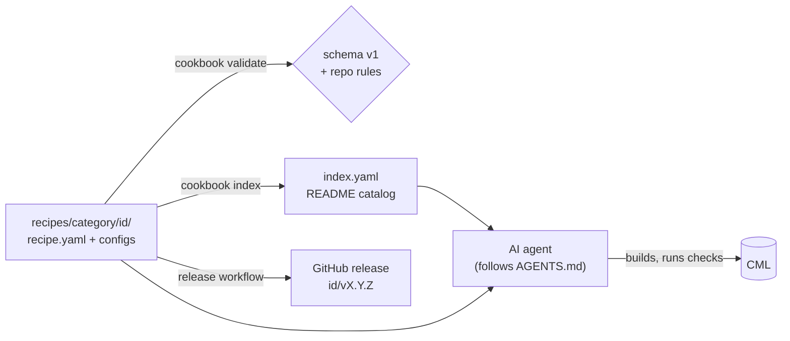

# Design

Why the cookbook is shaped the way it is. For the details of the format see [recipe-format.md](recipe-format.md); for versions see [versioning.md](versioning.md).

## Goal

A public collection of CML topologies that any AI agent, script or person can build the same way every time, and prove they work.

Today, asking an agent to "build me an OSPF lab in CML" gets a different lab every time, with addressing the agent made up and no agreed idea of what "working" means. A recipe pins all of that down: the nodes, the links, every config, and checks with pass and fail rules. The agent's job shrinks to building exactly what the recipe says and reporting the checks.

## Non-goals

- **Not tied to one tool.** Recipes don't depend on any particular MCP server, SDK or agent. [AGENTS.md](../AGENTS.md) describes what to do, not which tool calls to make.
- **Not a lab generator.** Recipes are fixed topologies, not templates with a size knob. "OSPF with N areas" is a different recipe for each N worth having.
- **Not an image or license source.** The repo never contains Cisco software.
- **Not a replacement for CML's own lab files.** CML's exported lab YAML is great for importing but says nothing about intent or what "working" means. Recipes carry both, and will render to CML lab YAML for importing (see the [roadmap](#roadmap)).

## Principles

1. **Fixed topology.** Every node, link, interface and address is decided by the recipe. The only values that vary are `inputs`, and they exist only for systems outside the lab.
2. **Day-0 first.** Every node should boot fully configured. `steps` exist for what genuinely can't be done at boot, such as registering an FTD with FMC.
3. **Every recipe proves itself.** Checks are machine-readable with defined pass rules, so two different agents report the same result for the same lab.
4. **Self-contained.** A recipe reads nothing from another recipe, so each one can be versioned, copied or deprecated on its own.
5. **Public-safe.** No real environments, secrets or Cisco software. Lab credentials are deliberately public and weak.
6. **Honest status.** A recipe is `stable` only after a real run passed, and the run is recorded in `tested_on`.

## How it fits together

- **`recipe.yaml`** is the source of truth for a recipe. Its README explains it to humans.
- **[`schema/v1/recipe.schema.json`](../schema/v1/recipe.schema.json)** defines the format, so any language can validate a recipe.
- **The `cookbook` CLI** adds the rules a schema can't express (references between fields, files that must exist, version bumps) and generates the catalog.
- **`index.yaml`** is committed so an agent can discover every recipe by fetching one file, without cloning.
- **CI** runs the CLI on every pull request, and tags and releases each new recipe version when it merges.

## Decisions

| Decision | Chosen | Why |
|---|---|---|
| What a recipe is | YAML spec + day-0 configs + README | Machine-checkable and readable by agents, while still explaining itself to humans. Prose alone isn't reproducible; CML exports alone carry no intent. |
| Tool coupling | Tool-agnostic | Recipes outlive any one MCP server or SDK version, and a public repo serves people with different tools. |
| Flexibility | Fixed topologies | Fixed labs are much easier to verify, document and support. Variation becomes separate recipes. |
| Configuration | Day-0 where possible, `steps` for the rest | Day-0 is the fastest and most reliable path. Some integrations (FMC registration, ISE) can only happen after boot. |
| Verification | Machine-readable checks with defined semantics | "Passed" means the same thing to every agent. |
| Security appliances | Mixed | FTDv and FMCv can run inside CML. ISE, Catalyst Center and Active Directory are usually too heavy, so they stay outside, reached through an external connector, with their values as `inputs`. |
| Size | Tagged per recipe | Any size is allowed. The catalog shows the smallest CML license tier each recipe fits. |
| Layout | Category folders | Easier to browse on GitHub as the collection grows. The category is read from the path and never repeated; IDs are unique across categories, and tags cover recipes that span categories. |
| Versioning | Per-recipe semver, git tags, no version folders | The tree stays clean, old versions stay reachable, and CI can enforce bumps. See [versioning.md](versioning.md). |
| Rendered CML labs | Release assets, not committed | Keeps generated files out of the tree. Only `index.yaml` and the README tables are committed, because agents and visitors read them straight from GitHub. |
| License | Apache-2.0 | Permissive, with an explicit patent grant. |

## Roadmap

**Now (no CML server needed)**

- [x] Recipe format, schema v1, conventions, versioning rules
- [x] `cookbook validate`, `index`, `new`, `version-check`, `release-plan`
- [x] CI and the release workflow
- [x] First draft recipe: `ospf-multi-area`
- [x] Draft the next three recipes of the first batch (below)

**With a CML server**

- [x] Test the four drafted recipes end to end on CML 2.10.0, fix what broke, and record `tested_on` and `ram_mb` (2026-10-17)
- [x] Promote the tested recipes to `1.0.0` stable, after a second run rebuilt from GitHub
- [ ] Draft and test the two security recipes
- [ ] `cookbook render <id>`: write an importable CML lab YAML file for a recipe (needs the interface naming of each node definition, which has to be checked against a real server)
- [ ] `cookbook check <id>`: run a recipe's checks against a running lab, as a reference implementation of the check rules
- [ ] Attach rendered lab files to each recipe release

**First batch**

| Recipe | Category | Notes |
|---|---|---|
| `ospf-multi-area` | routing-switching | Stable, 1.0.0 |
| `bgp-dual-isp-edge` | routing-switching | Stable, 1.0.0 (after a config-ordering fix) |
| `campus-3-tier` | enterprise | Stable, 1.0.0 (after a config-ordering fix and replacing HSRP tracking, which IOL L2 lacks) |
| `dmvpn-branch-wan` | enterprise | Stable, 1.0.0 |
| `ftd-internet-edge` | security | FTDv managed by FMCv. Needs non-refplat images and a lot of RAM. |
| `dot1x-access-ise` | security | Access switch with 802.1X and MAB against an external ISE and AD. Need to confirm which CML switch image handles 802.1X well. |

**Later**

- `nxos-vxlan-evpn` (data center fabric, very RAM-hungry)
- IPv6 variants of the routing recipes
- Break/fix variants: the same topology with a deliberate fault and checks that pass once it's fixed

## Open questions

- Which CML switch image supports 802.1X and MAB well enough for `dot1x-access-ise`.
- How `cookbook render` should map interface labels to slots for each node definition, ideally without hard-coding a table per image.
- Whether the minimum CML version for IOL recipes should be 2.7. That depends on when the `iol-xe` node definitions first shipped, which needs checking.
