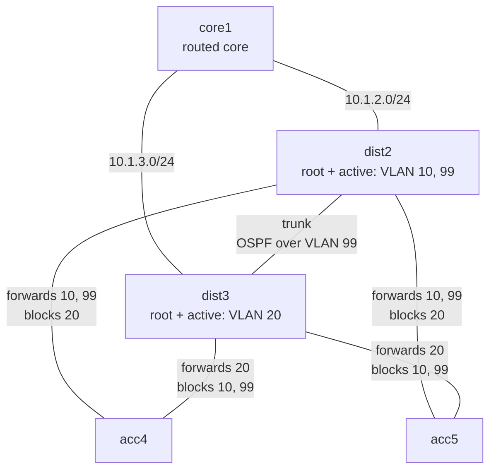

# Three-tier campus

> **Status: stable.** Tested on CML 2.10.0 with IOL XE and IOL L2 XE 17.18.02 (2026-10-17). If it doesn't work for you, please [report it](https://github.com/dr-stutters/cml-cookbook/issues/new?template=recipe-broken.yml).

The classic campus design, cut down to five nodes. A routed core connects to a pair of distribution switches over OSPF. The distribution pair is the Layer 3 boundary: it owns the gateways for three VLANs with HSRP and trunks those VLANs down to two access switches, each dual-homed to both distribution switches. Rapid PVST+ blocks one uplink per VLAN on each access switch.

The design point the lab shows is **alignment**: for each VLAN, the same distribution switch is both the spanning-tree root and the HSRP active router. dist2 handles VLANs 10 and 99 and dist3 handles VLAN 20, so both distribution switches and both uplinks of each access switch carry traffic, and nothing crosses the inter-distribution trunk in normal operation. The distribution switches also run OSPF with each other over VLAN 99, so one that loses its uplink to the core routes through its peer instead of dropping its VLANs' traffic.

## Topology

The labels on the access uplinks show what spanning tree does with each VLAN there. The blocking happens on the access switch's end of the link.

| Node | Image | Role | Loopback0 | Management |
|---|---|---|---|---|
| core1 | iol-xe | Routed core | 10.255.0.1 | |
| dist2 | ioll2-xe | Distribution, STP root and HSRP active for VLANs 10 and 99 | 10.255.0.2 | 172.16.99.2 |
| dist3 | ioll2-xe | Distribution, STP root and HSRP active for VLAN 20 | 10.255.0.3 | 172.16.99.3 |
| acc4 | ioll2-xe | Layer 2 access | | 172.16.99.4 |
| acc5 | ioll2-xe | Layer 2 access | | 172.16.99.5 |

5 licensed nodes, so it fits CML-Free. Only reference platform images. core1 only routes, so it uses the IOL router image; the others use the IOL Layer 2 image. A real campus would have a core pair too; one core router is enough to show the distribution layer's job.

There are no end hosts, to stay inside CML-Free's five nodes, and the access switches have no user ports configured, since the cookbook leaves unused interfaces out of the config. Each access switch's management address in VLAN 99 is the endpoint the checks ping instead. See [Things to try](#things-to-try) to add a host.

## Addressing

| Link | Subnet | Notes |
|---|---|---|
| core1 Ethernet0/1 – dist2 Ethernet0/1 | 10.1.2.0/24 | Routed, OSPF area 0 |
| core1 Ethernet0/2 – dist3 Ethernet0/1 | 10.1.3.0/24 | Routed, OSPF area 0 |
| dist2 Ethernet0/2 – dist3 Ethernet0/2 | | Trunk, VLANs 10, 20, 99 |
| dist2 Ethernet0/3 – acc4 Ethernet0/1 | | Trunk, VLANs 10, 20, 99 |
| dist3 Ethernet0/3 – acc4 Ethernet0/2 | | Trunk, VLANs 10, 20, 99 |
| dist2 Ethernet1/0 – acc5 Ethernet0/1 | | Trunk, VLANs 10, 20, 99 |
| dist3 Ethernet1/0 – acc5 Ethernet0/2 | | Trunk, VLANs 10, 20, 99 |

On each routed link, node X uses `.X`. dist2 and dist3 each have four lab links, so with `Ethernet0/0` left free they need `Ethernet1/0` as well as `Ethernet0/1`–`Ethernet0/3`.

| VLAN | Name | Subnet | Gateway (HSRP) | STP root and HSRP active | Secondary |
|---|---|---|---|---|---|
| 10 | DATA | 172.16.10.0/24 | 172.16.10.1 | dist2 (priority 24576, HSRP 110) | dist3 |
| 20 | VOICE | 172.16.20.0/24 | 172.16.20.1 | dist3 (priority 24576, HSRP 110) | dist2 |
| 99 | MGMT | 172.16.99.0/24 | 172.16.99.1 | dist2 (priority 24576, HSRP 110) | dist3 |

The secondary has STP priority 28672 and the default HSRP priority of 100, and both preempt. VLANs 10 and 20 are passive in OSPF. VLAN 99 isn't, and is point-to-point, so dist2 and dist3 form an adjacency with each other over it as well as with core1. That's what protects against an uplink failure here: the IOL Layer 2 image has no object tracking (`track` isn't a command on it), so HSRP can't follow the uplink's state. core1's Loopback1 (172.16.1.1/24) stands in for the data center and shared services.

## Build

Every node boots fully configured, so there are no post-boot steps.

- **With an AI agent:** ask it to build `campus-3-tier` from this repo and run its checks. [AGENTS.md](../../../AGENTS.md) tells it how.
- **By hand:** create the five nodes and seven links in the tables above in the CML UI (add a fifth interface to dist2 and dist3 if CML doesn't create one), paste each file from [`configs/`](configs/) into the node's config before starting it, then start the lab.

## Checks

| Check | What it proves |
|---|---|
| `core1-ospf-neighbors`, `dist2-ospf-neighbors`, `dist3-ospf-neighbors` | Each distribution switch is FULL with core1 and with its peer over VLAN 99, and VLANs 10 and 20 form no adjacencies |
| `core1-ecmp-to-data` | core1 learns VLAN 10 from both distribution switches and load-shares |
| `dist2-stp-root-vlan10`, `dist3-stp-root-vlan20` | Each VLAN's root is where the design puts it |
| `acc4-stp-vlan10` … `acc5-stp-vlan20` | Each access switch forwards toward the root and blocks the other uplink, per VLAN |
| `dist2-hsrp`, `dist3-hsrp` | HSRP active and standby match the spanning-tree roots |
| `ping-core1-data-gateway`, `ping-core1-voice-gateway` | The core reaches both VLAN gateways, owned by different distribution switches |
| `ping-core1-acc4`, `ping-core1-acc5` | The core's loopback reaches the access layer through the distribution switches and VLAN 99 |
| `ping-acc5-services` | An access switch reaches the core's services network through its HSRP gateway |

The exact commands and expected output are in [`recipe.yaml`](recipe.yaml).

## Things to try

- Shut dist2 Ethernet0/1 (its uplink to core1). dist2 stays HSRP active for VLANs 10 and 99, but `show ip route 172.16.1.0` on dist2 now points at dist3 over VLAN 99, and core1 still reaches VLAN 10. On a platform with object tracking, compare with making HSRP hand the gateway to dist3 instead.
- Swap the STP priorities for VLAN 10 without touching HSRP. acc4's VLAN 10 frames now go up to dist3 and across the trunk to reach their gateway on dist2, a path `traceroute` can't show because it's all Layer 2. Follow it with `show spanning-tree vlan 10` on acc4 and dist3.
- Add a host: connect an Alpine or IOL node to acc4 Ethernet0/3, make that port `switchport mode access`, `switchport access vlan 10` and `spanning-tree portfast`, and give the host 172.16.10.10/24 with gateway 172.16.10.1.
- Turn the dist2–dist3 trunk into a two-link EtherChannel with LACP.
- Replace HSRP with VRRP or GLBP and compare how each one shares the load.
