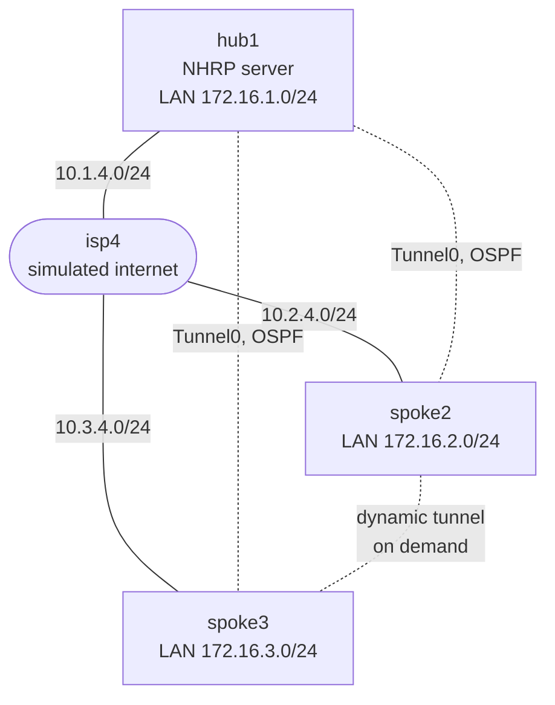

# DMVPN branch WAN

> **Status: draft.** Written but not yet tested on a real CML. Expect rough edges, and please [report anything that doesn't work](https://github.com/dr-stutters/cml-cookbook/issues/new?template=recipe-broken.yml).

A head office and two branches connected over a simulated internet with DMVPN Phase 3. Each site has one internet link. hub1 is the NHRP server; the spokes register their internet (NBMA) addresses with it and form a single multipoint GRE overlay, 172.16.0.0/24, with OSPF running over it.

Phase 3 is about splitting routing from forwarding:

- **Routing goes through the hub.** OSPF runs point-to-multipoint on the tunnel, so the spokes only peer with hub1 and every branch route points at hub1 as its next hop. Routing scales with the number of spokes, not the number of spoke pairs.
- **Forwarding goes direct.** When branch-to-branch traffic arrives at hub1 and goes straight back out the tunnel, hub1 sends an NHRP redirect. The spoke resolves the other spoke's NBMA address, builds a direct tunnel and overrides the next hop for that prefix. The checks prove both halves.

## Topology

Solid lines are the underlay; dotted lines are the DMVPN overlay.

| Node | Image | Role | Loopback0 | Tunnel0 | NBMA address |
|---|---|---|---|---|---|
| hub1 | iol-xe | DMVPN hub and NHRP server | 10.255.0.1 | 172.16.0.1 | 10.1.4.1 |
| spoke2 | iol-xe | Branch spoke | 10.255.0.2 | 172.16.0.2 | 10.2.4.2 |
| spoke3 | iol-xe | Branch spoke | 10.255.0.3 | 172.16.0.3 | 10.3.4.3 |
| isp4 | iol-xe | Simulated internet | | | |

4 licensed nodes, so it fits CML-Free. Only reference platform images.

isp4 runs no routing protocol: every site's link is directly connected to it, and each site has a static default route pointing at it. That's all the underlay a DMVPN needs, and it keeps the underlay's addresses out of OSPF, which avoids recursive routing through the tunnel.

The tunnels are plain mGRE without IPsec, to keep the lab focused on NHRP and routing. A real deployment always adds tunnel protection; see [Things to try](#things-to-try).

## Addressing

| Link | Subnet | Notes |
|---|---|---|
| hub1 Ethernet0/1 – isp4 Ethernet0/1 | 10.1.4.0/24 | hub1's internet link, tunnel source |
| spoke2 Ethernet0/1 – isp4 Ethernet0/2 | 10.2.4.0/24 | spoke2's internet link, tunnel source |
| spoke3 Ethernet0/1 – isp4 Ethernet0/3 | 10.3.4.0/24 | spoke3's internet link, tunnel source |
| Tunnel0 on hub1, spoke2, spoke3 | 172.16.0.0/24 | DMVPN overlay, OSPF area 0, point-to-multipoint |

On each link, node X uses `.X`. Each site's Loopback1 stands in for its LAN: 172.16.1.1/24 on hub1, 172.16.2.1/24 on spoke2 and 172.16.3.1/24 on spoke3, all advertised into OSPF as `/24`s.

## Build

Every node boots fully configured, so there are no post-boot steps.

- **With an AI agent:** ask it to build `dmvpn-branch-wan` from this repo and run its checks. [AGENTS.md](../../../AGENTS.md) tells it how.
- **By hand:** create the four nodes and three links in the tables above in the CML UI, paste each file from [`configs/`](configs/) into the node's config before starting it, then start the lab.

OSPF on a point-to-multipoint interface uses 30-second hellos, so the adjacencies can take up to a minute to come up after boot.

## Checks

| Check | What it proves |
|---|---|
| `hub1-ospf-neighbors`, `spoke2-ospf-neighbors`, `spoke3-ospf-neighbors` | OSPF runs hub-and-spoke over the tunnel, with no spoke-to-spoke adjacency |
| `hub1-nhrp-registrations` | Both spokes registered their NBMA addresses with hub1 |
| `spoke2-route-via-hub` | The routing table sends branch-to-branch traffic to hub1 |
| `ping-spoke2-hub-lan`, `ping-spoke3-hub-lan` | Each branch LAN reaches the head-office LAN over the overlay |
| `ping-spoke2-spoke3-lan` | Branch-to-branch reachability, which also triggers the NHRP redirect |
| `spoke2-shortcut` | Branch-to-branch traffic now takes the direct tunnel: the first traceroute hop is spoke3 |
| `spoke2-dynamic-tunnel` | spoke2 holds a dynamic NHRP entry for spoke3 |

The last two checks depend on branch-to-branch traffic having flowed, so run them in the order listed. `spoke2-shortcut` sends that traffic itself, so retrying it is enough. The exact commands and expected output are in [`recipe.yaml`](recipe.yaml).

## Things to try

- Right after boot, before any branch-to-branch traffic, run `show dmvpn` and `traceroute 172.16.3.1 source Loopback1` on spoke2. Then run the traceroute again and compare. Look at `show ip route 172.16.3.0` and `show ip nhrp shortcut` to see how NHRP overrides the OSPF next hop.
- Remove `ip nhrp redirect` from hub1 and clear the spokes' NHRP caches with `clear ip nhrp`. Branch-to-branch traffic now always goes through the hub: that's Phase 1 behavior.
- Add IPsec, if your image supports it: an IKEv2 profile with a pre-shared key and an IPsec profile, applied with `tunnel protection ipsec profile` on every Tunnel0. Watch the dynamic tunnels come up with IKE sessions too.
- Add a second hub on its own internet link for redundancy, with both hubs as NHRP servers on each spoke.
- Swap OSPF for EIGRP, and have the hub send the spokes only a summary of 172.16.0.0/16. The spokes then learn NHRP routes (`H` in the routing table) for each other's LANs instead of overriding a next hop.
