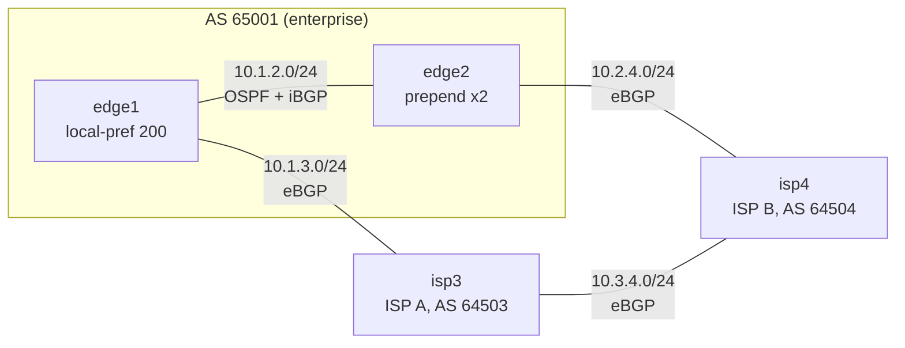

# BGP dual-ISP edge

> **Status: draft.** Passed all of its checks on CML 2.10.0 with IOL XE 17.18.02 on 2026-10-17, but isn't marked stable yet. Please [report anything that doesn't work](https://github.com/dr-stutters/cml-cookbook/issues/new?template=recipe-broken.yml).

An enterprise in AS 65001 is multihomed to two simulated ISPs through two edge routers. edge1 connects to ISP A (isp3), edge2 to ISP B (isp4), and the edges run iBGP between their loopbacks over OSPF. Both edges advertise the enterprise's public block, 203.0.113.0/24.

ISP A is the primary in both directions, using the two classic tools:

- **Outbound:** edge1 sets local preference 200 on everything from ISP A. iBGP carries that to edge2, so even traffic for ISP B's own prefix leaves through edge1.
- **Inbound:** edge2 prepends AS 65001 twice toward ISP B, so the rest of the internet sees a longer path through ISP B and prefers ISP A.
- **No transit:** each edge only advertises the enterprise block, so the two ISPs never reach each other through AS 65001.

If either ISP link fails, the other edge carries everything. That's the first thing to try once the lab is up.

## Topology

| Node | Image | Role | Loopback0 | Loopback1 |
|---|---|---|---|---|
| edge1 | iol-xe | Enterprise edge to ISP A, local preference 200 inbound | 10.255.0.1 | 203.0.113.1/32 |
| edge2 | iol-xe | Enterprise edge to ISP B, AS-path prepend outbound | 10.255.0.2 | 203.0.113.2/32 |
| isp3 | iol-xe | ISP A, AS 64503 | 10.255.0.3 | 198.51.100.1/25 |
| isp4 | iol-xe | ISP B, AS 64504 | 10.255.0.4 | 198.51.100.129/25 |

4 licensed nodes, so it fits CML-Free. Only reference platform images.

## Addressing

| Link | Subnet | Notes |
|---|---|---|
| edge1 Ethernet0/1 – edge2 Ethernet0/1 | 10.1.2.0/24 | OSPF area 0, carries iBGP between the loopbacks |
| edge1 Ethernet0/2 – isp3 Ethernet0/1 | 10.1.3.0/24 | eBGP, AS 65001 – AS 64503 |
| edge2 Ethernet0/2 – isp4 Ethernet0/1 | 10.2.4.0/24 | eBGP, AS 65001 – AS 64504 |
| isp3 Ethernet0/2 – isp4 Ethernet0/2 | 10.3.4.0/24 | eBGP between the ISPs, standing in for the rest of the internet |

On each link, node X uses `.X`.

| Prefix | Originated by | Notes |
|---|---|---|
| 203.0.113.0/24 | edge1 and edge2 | The enterprise block, anchored by a static route to Null0 on each edge. Each edge's Loopback1 (203.0.113.N/32) stands in for a server inside it and is carried in OSPF. |
| 198.51.100.0/25 | isp3 | The internet behind ISP A |
| 198.51.100.128/25 | isp4 | The internet behind ISP B |

The "public" prefixes come from the RFC 5737 documentation ranges and the ISP AS numbers from the RFC 5398 documentation range. The ISP links use the cookbook's usual `10.X.Y.0/24` point-to-point plan to keep the lab easy to read.

## Build

Every node boots fully configured, so there are no post-boot steps.

- **With an AI agent:** ask it to build `bgp-dual-isp-edge` from this repo and run its checks. [AGENTS.md](../../../AGENTS.md) tells it how.
- **By hand:** create the four nodes and four links in the tables above in the CML UI, paste each file from [`configs/`](configs/) into the node's config before starting it, then start the lab.

## Checks

| Check | What it proves |
|---|---|
| `edge1-ospf-neighbors`, `edge2-ospf-neighbors` | The edges are adjacent, so the iBGP loopbacks are reachable |
| `edge1-bgp-neighbors` … `isp4-bgp-neighbors` | All four BGP sessions are Established |
| `edge1-local-pref` | edge1 applies local preference 200 to routes from ISP A |
| `edge2-outbound-via-edge1` | edge2 prefers the iBGP path through edge1 even for ISP B's own prefix |
| `isp4-sees-prepend` | edge2's prepending reaches ISP B as `65001 65001 65001` |
| `isp4-inbound-via-isp3` | ISP B sends traffic for the enterprise through ISP A instead of the prepended direct path |
| `isp4-no-transit` | edge2 advertises nothing but the enterprise block |
| `ping-edge2-isp-b`, `ping-edge2-isp-a`, `ping-isp4-edge2` | Reachability between the enterprise block and both ISPs, sourced from loopbacks |

The exact commands and expected output are in [`recipe.yaml`](recipe.yaml).

## Things to try

- On edge2, run `traceroute 198.51.100.129 source Loopback1`. Then shut edge1 Ethernet0/2 and run it again to watch outbound traffic fail over to ISP B. Look at `show ip bgp 203.0.113.0/24` on isp3 while you're there.
- On edge2, remove `match ip address prefix-list ENTERPRISE` from route-map ISP-B-OUT, clear the session with `clear ip bgp 10.2.4.4 soft out`, and look at `show ip bgp neighbors 10.2.4.2 routes` on isp4. That's a transit leak.
- Real ISPs usually give customer routes a higher local preference than peer routes, which makes prepending useless inside ISP B itself. Add an inbound route-map on isp4 that sets local preference 150 for edge2, and watch `isp4-inbound-via-isp3` start failing. Many ISPs let customers lower that preference with a BGP community instead.
- Swap the roles: move the local preference to edge2 and the prepending to edge1, and predict every check's result before running them.
