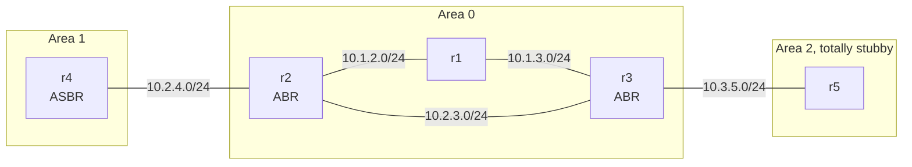

# OSPF multi-area

> **Status: draft.** Written but not yet tested on a real CML. Expect rough edges, and please [report anything that doesn't work](https://github.com/dr-stutters/cml-cookbook/issues/new?template=recipe-broken.yml).

Five IOL routers in three OSPF areas. The backbone is a triangle of r1, r2 and r3. Area 1 hangs off r2 and contains r4, which redistributes a LAN as an external route. Area 2 hangs off r3 and is totally stubby, so r5 sees nothing outside its area except a default route.

It's a compact lab for seeing how each LSA type travels: router and network LSAs inside an area, summary LSAs between areas, external LSAs from an ASBR, and what a totally stubby area filters out.

## Topology

| Node | Image | Role | Loopback0 |
|---|---|---|---|
| r1 | iol-xe | Area 0 internal router | 10.255.0.1 |
| r2 | iol-xe | ABR, areas 0 and 1 | 10.255.0.2 |
| r3 | iol-xe | ABR, areas 0 and 2 | 10.255.0.3 |
| r4 | iol-xe | Area 1 router, ASBR for 172.16.4.0/24 | 10.255.0.4 |
| r5 | iol-xe | Area 2 router | 10.255.0.5 |

5 licensed nodes, so it fits CML-Free. Only reference platform images.

## Addressing

| Link | Subnet | Area |
|---|---|---|
| r1 Ethernet0/1 – r2 Ethernet0/1 | 10.1.2.0/24 | 0 |
| r1 Ethernet0/2 – r3 Ethernet0/1 | 10.1.3.0/24 | 0 |
| r2 Ethernet0/2 – r3 Ethernet0/2 | 10.2.3.0/24 | 0 |
| r2 Ethernet0/3 – r4 Ethernet0/1 | 10.2.4.0/24 | 1 |
| r3 Ethernet0/3 – r5 Ethernet0/1 | 10.3.5.0/24 | 2 |

On each link, router X uses `.X`. r4's Loopback1 (172.16.4.1/24) is redistributed as an external type 2 route. r5's Loopback1 (172.16.5.1/24) is advertised inside area 2 as a `/24`.

## Build

Every node boots fully configured, so there are no post-boot steps.

- **With an AI agent:** ask it to build `ospf-multi-area` from this repo and run its checks. [AGENTS.md](../../../AGENTS.md) tells it how.
- **By hand:** create the five nodes and five links in the table above in the CML UI, paste each file from [`configs/`](configs/) into the node's config before starting it, then start the lab.

## Checks

| Check | What it proves |
|---|---|
| `r1-ospf-neighbors` … `r5-ospf-neighbors` | Every adjacency is FULL with the expected router IDs |
| `r1-external-route` | r4's redistributed LAN reaches r1 as `O E2` |
| `r1-inter-area-route` | r5's LAN reaches r1 as `O IA` |
| `r5-totally-stubby` | r5 has an `O*IA` default route and no inter-area or external specifics |
| `ping-r4-r5` | Loopback-to-loopback reachability across all three areas |
| `ping-r1-external-lan` | r1 can reach the redistributed LAN |

The exact commands and expected output are in [`recipe.yaml`](recipe.yaml).

## Things to try

- On r1, run `show ip ospf database` and match each LSA type to the router that originated it.
- On r3, remove `no-summary` from `area 2 stub` and watch r5 pick up the inter-area routes, but still not the external one.
- Change area 2 to an NSSA and give r5 its own redistributed LAN.
- Run `traceroute 10.255.0.5 source Loopback0` on r4, then shut r2 Ethernet0/2 and run it again to watch the path move through r1.
