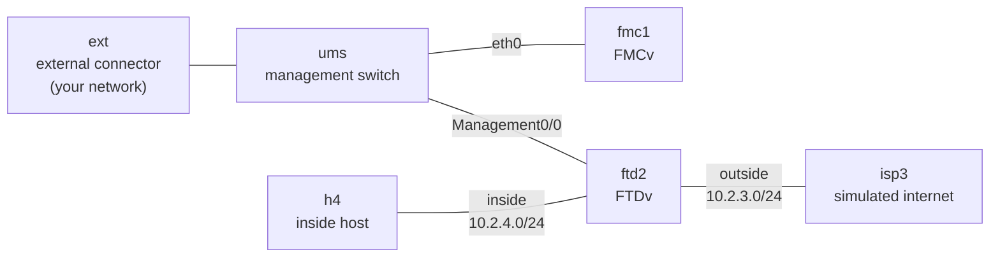

# FTD internet edge with FMC

> **Status: draft.** Passed all of its checks on CML 2.10.0 with FMCv 10.0.1 and FTDv 10.0.0 (2026-10-17), but isn't marked stable yet. Please [report anything that doesn't work](https://github.com/dr-stutters/cml-cookbook/issues/new?template=recipe-broken.yml).

> **This lab connects to your network.** An external connector bridges the management switch out of CML, so fmc1 and ftd2's management port sit on a real network with addresses you choose. Use a lab network, never expose it to an untrusted one, and pick a strong `admin_password`.

An FTDv internet edge managed by an FMCv in the same lab. ftd2 registers itself to fmc1 from its day-0 config. You (or an agent with FMC's REST API) then do what you'd do on day one in FMC: turn on licensing, build the zones and an access policy, register the device, give it its interfaces, a default route and PAT, and deploy.

The data side is self-contained. h4 is an inside host. isp3 stands in for the internet: it has a "web server" at 198.51.100.1 and a site the policy blocks at 198.51.100.66, and it has **no route back to the inside network**. So the only way h4's pings come back is if ftd2 translates them to its outside address. A working ping proves the routing, the access policy and NAT together.

## Topology



| Node | Image | Role | Licensed |
|---|---|---|---|
| fmc1 | fmcv | Firewall Management Center, manages ftd2 | yes |
| ftd2 | ftdv | Internet edge firewall | yes |
| isp3 | iol-xe | Simulated ISP and internet | yes |
| h4 | iol-xe | Inside host | yes |
| ums | unmanaged_switch | Management segment | no |
| ext | external_connector | Bridges management out of CML (System Bridge) | no |

4 licensed nodes, but this lab needs about **42 GB of RAM** (FMCv alone takes 32 GB) and the FMCv and FTDv images, which aren't on the reference platform ISO. Plan for **30–45 minutes** before FMC's web UI answers on first boot.

## Addressing

| Where | Address | Notes |
|---|---|---|
| fmc1 eth0 | `fmc_ip` input | Your management network |
| ftd2 Management0/0 | `ftd_mgmt_ip` input | Same network, reaches fmc1 through ums |
| ftd2 outside (GigabitEthernet0/0) | 10.2.3.2/24 | FMC calls it Ethernet0/0 |
| isp3 Ethernet0/1 | 10.2.3.3/24 | ftd2's default gateway |
| ftd2 inside (GigabitEthernet0/1) | 10.2.4.2/24 | FMC calls it Ethernet0/1 |
| h4 Ethernet0/1 | 10.2.4.4/24 | Default route to 10.2.4.2 |
| isp3 Loopback1 | 198.51.100.1 | "Web server", allowed |
| isp3 Loopback2 | 198.51.100.66 | "Blocked site", denied by the access policy |

The firewall's own interfaces use the cookbook's usual `10.X.Y.0/24` links. FMC rejects interface addresses in some documentation ranges (such as 203.0.113.0/24).

## Inputs

| Input | What it is |
|---|---|
| `admin_password` | Password for admin on fmc1 and ftd2 (secret). It must be strong: FTD forces a change at first login if it's weak or a dictionary word. |
| `fmc_ip`, `ftd_mgmt_ip` | Two free addresses on your management network |
| `mgmt_mask`, `mgmt_gateway`, `mgmt_dns` | That network's mask, gateway and DNS server |

The registration key between ftd2 and fmc1 is fixed as `cookbook`. It only matters inside the lab.

## Build

ftd2, isp3 and h4 boot fully configured, and ftd2 points itself at fmc1. Everything else happens in FMC after boot, because a device managed by FMC takes its configuration from FMC, not from day-0 config.

- **With an AI agent:** ask it to build `ftd-internet-edge` from this repo and run its checks. [AGENTS.md](../../../AGENTS.md) tells it how. It will ask you for the inputs. It needs a way to reach FMC's web UI or REST API on your management network to do the steps.
- **Import a lab file:** this recipe needs your values, so its releases don't include one. Make it yourself, then import it in CML (Dashboard → Import) and start it:

  ```bash
  cookbook render ftd-internet-edge -o ftd-lab.yaml --input admin_password='...' --input fmc_ip=192.0.2.10 --input ftd_mgmt_ip=192.0.2.11 --input mgmt_mask=255.255.255.0 --input mgmt_gateway=192.0.2.1 --input mgmt_dns=192.0.2.53
  ```

  The file contains your admin password, so keep it private.
- **By hand:** create the six nodes and five links in the tables above, paste each file from [`configs/`](configs/) into its node's config (replacing the `{{ inputs.… }}` values), and start the lab.

Then do the steps in [`recipe.yaml`](recipe.yaml), in order:

1. **Evaluation licence.** FMC refuses to register devices without it.
2. **Zones and access policy.** Create zones `inside` and `outside`, and a `cookbook-edge` policy: block 198.51.100.66, allow inside to outside, block everything else.
3. **Register ftd2**, with registration key `cookbook` and the `cookbook-edge` policy. Allow about 6 minutes.
4. **Interfaces, default route and PAT.** `outside` 10.2.3.2/24 and `inside` 10.2.4.2/24, a default route via 10.2.3.3, and an auto NAT rule for 10.2.4.0/24 translated to the outside interface.
5. **Deploy.**

The console logins for fmc1 and ftd2 are `admin` with your `admin_password`; the IOL nodes use the cookbook's `cisco` / `cisco`.

## Checks

| Check | What it proves |
|---|---|
| `fmc1-evaluation-mode` | FMC is licensed, so it can manage devices (manual) |
| `ftd2-registered` | ftd2's registration with fmc1 completed |
| `ftd2-interfaces` | outside and inside are up with the addresses FMC deployed |
| `ftd2-default-route` | The default route through isp3 was deployed |
| `ping-h4-internet` | h4 reaches the internet, which only works through PAT |
| `ping-h4-blocked-site` | The access policy blocks 198.51.100.66 |
| `ftd2-pat-hits` | The auto NAT rule translated h4's traffic |

The exact commands and expected output are in [`recipe.yaml`](recipe.yaml).

## Things to try

- Run `packet-tracer input inside icmp 10.2.4.4 8 0 198.51.100.66` on ftd2 and find the rule that drops it.
- Look at the connection events in FMC (Analysis > Connections > Events) after h4's pings. Turn on logging for the rules first.
- Add a second inside host and a rule that only lets it reach the web server over HTTPS.
- Replace the auto NAT rule with a manual NAT rule, and compare `show nat` before and after.
