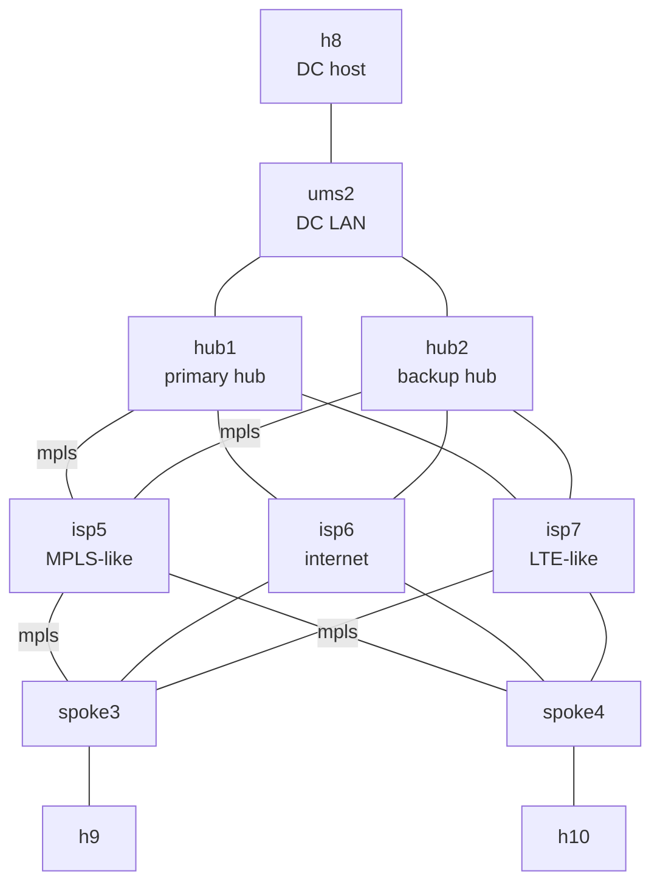

# FTD SD-WAN with a backup hub

> **Status: draft.** Written but not yet tested on a real CML in this form. Please [report anything that doesn't work](https://github.com/dr-stutters/cml-cookbook/issues/new?template=recipe-broken.yml).

> **The example values come from the author's lab.** The 198.18.x.x addresses (FMC, management network, FTD management ports) and every password shown on this page are examples from the author's lab or made up for the docs. Replace them with your own. In particular, never use an example password on a real device.

> **This lab connects to your network.** An external connector bridges the FTDs' management ports out of CML so they can reach your FMC. Use a lab network, never an untrusted one, and pick a strong `admin_password`.

Secure Firewall SD-WAN with hub redundancy. Two hubs, a primary and a backup, sit on the same data center LAN, and two branch firewalls each keep an IPsec tunnel and an iBGP session to both. The spokes send traffic through the primary hub. When it fails, they move to the backup.

Your FMC builds it all with its SD-WAN wizard: each hub has its own dynamic VTI and its own spoke address pool, and FMC generates the iBGP overlay. ECMP (multipath) is off on purpose. With it on, spokes would spread traffic over both hubs, but the DC LAN routes back through hub1 only, so the return traffic would be asymmetric and get dropped.

It's the companion to [`ftd-sdwan-single-hub`](../ftd-sdwan-single-hub/): the same carriers, ports, addressing scheme and FMC steps, with a second hub instead of backup WAN links.

## Before you start

This recipe assumes you already have:

- **An FMC, 7.6 or later** (tested with 10.0.1), that the management network can reach and that has room for four more devices. The lab doesn't include one.
- **The FMC registered to a Smart Account with Export-Controlled Features enabled.** FMC won't deploy the strong (AES) IPsec encryption the tunnels use without it, and evaluation mode doesn't count.
- **The FTDv image in CML** (tested with 10.0.0, the same version as the FMC or older), and room for 10 licensed nodes. The four FTDv nodes take 8 GB of RAM each, about 37 GB for the whole lab.
- **A management network** the external connector (System Bridge) reaches, with four free addresses and a route to the FMC.
- **One FMC domain for everything.** That's Global on most FMCs. Only if yours has child domains (`Global/<something>`) does it matter: FMC won't register devices in a domain with children, so do everything in one of the child domains (the author's lab uses `Global/mcp-test-leaf`).

## Topology



Every tunnel runs over mpls: each spoke has one to hub1 and one to hub2. The FTDs' management ports (not drawn) share `ums`, which `ext` bridges to your network.

| Node | Image | Role | Licensed |
|---|---|---|---|
| hub1 | ftdv | Primary SD-WAN hub | yes |
| hub2 | ftdv | Backup SD-WAN hub | yes |
| spoke3, spoke4 | ftdv | Branches with a tunnel to each hub | yes |
| isp5 | iol-xe | MPLS-like carrier | yes |
| isp6 | iol-xe | Internet carrier (built and routed, no tunnels) | yes |
| isp7 | iol-xe | LTE-like carrier (built and routed, no tunnels) | yes |
| h8 | alpine | Host on the DC LAN | yes |
| h9, h10 | alpine | Hosts on the branch LANs | yes |
| ums2 | unmanaged_switch | The DC LAN both hubs share | no |
| ums | unmanaged_switch | Management segment | no |
| ext | external_connector | Bridges management out of CML (System Bridge) | no |

10 licensed nodes, so it needs CML's `personal` tier or bigger. The FTDv image isn't on the reference platform ISO. Plan for **15–30 minutes** before the FTDs finish booting.

Every FTD uses the same ports, which CML calls GigabitEthernet0/x and FMC calls Ethernet0/x:

| Port | Name in FMC | Zone | Connects to |
|---|---|---|---|
| Management0/0 | (management) | | ums |
| GigabitEthernet0/0 | mpls | sdwan-dual-wan | isp5 |
| GigabitEthernet0/1 | inet | sdwan-dual-wan | isp6 |
| GigabitEthernet0/2 | lte | sdwan-dual-wan | isp7 |
| GigabitEthernet0/3 | inside | sdwan-dual-inside | the DC LAN (hubs) or the site's host (spokes) |

## Addressing

The same scheme as `ftd-sdwan-single-hub`: each carrier owns `10.C.0.0/16` (C is its node number), and the link from carrier C to the FTD numbered N is `10.C.N.0/24`, with the FTD at `.N` and the carrier at `.C`.

| | mpls (isp5) | inet (isp6) | lte (isp7) | inside |
|---|---|---|---|---|
| hub1 | 10.5.1.1/24 | 10.6.1.1/24 | 10.7.1.1/24 | 172.16.1.1/24 (DC LAN) |
| hub2 | 10.5.2.2/24 | 10.6.2.2/24 | 10.7.2.2/24 | 172.16.1.2/24 (DC LAN) |
| spoke3 | 10.5.3.3/24 | 10.6.3.3/24 | 10.7.3.3/24 | 172.16.3.1/24 |
| spoke4 | 10.5.4.4/24 | 10.6.4.4/24 | 10.7.4.4/24 | 172.16.4.1/24 |

Hosts: h8 172.16.1.8 (default route to hub1, 172.16.1.1), h9 172.16.3.9, h10 172.16.4.10.

| Overlay | Hub tunnel address | Spoke tunnel pool |
|---|---|---|
| To hub1 (primary) | 10.255.1.1 (loopback `sdwan-dvti-lo` on hub1) | `sdwan-dual-pool`, 10.255.1.2–.254 |
| To hub2 (backup) | 10.255.2.1 (loopback `sdwan-dvti-lo` on hub2) | `sdwan-dual-backup-pool`, 10.255.2.2–.254 |

## Inputs

The examples are from the author's lab. Use your own.

| Input | What it is | Example |
|---|---|---|
| `admin_password` | Password for admin on the four FTDs (secret). It must be strong. | `Sdwan#Lab-2026` (made up) |
| `fmc_ip` | Your FMC's management address | `198.18.134.76` |
| `hub1_mgmt_ip` | hub1's Management0/0 address | `198.18.128.228` |
| `hub2_mgmt_ip` | hub2's Management0/0 address | `198.18.128.229` |
| `spoke3_mgmt_ip` | spoke3's Management0/0 address | `198.18.128.230` |
| `spoke4_mgmt_ip` | spoke4's Management0/0 address | `198.18.128.231` |
| `mgmt_mask` | The management network's mask | `255.255.192.0` |
| `mgmt_gateway` | Its default gateway | `198.18.128.1` |
| `mgmt_dns` | A DNS server the FTDs use | `198.18.133.1` |

Other credentials in the lab:

| What | Value |
|---|---|
| FTD console (hub1, hub2, spoke3, spoke4) | `admin` / your `admin_password` |
| IOL carriers (isp5–7) and Alpine hosts (h8–h10) | `cisco` / `cisco` (the cookbook's lab-only login) |
| FTD to FMC registration key | `cookbook` (only used once, inside the lab) |
| Your FMC login | Your own FMC admin or API user, for example `cookbook-api` / `Fmc-Api#Lab-2026` (made up) |

## Build

The carriers and hosts boot fully configured, and each FTD points itself at your FMC from its day-0 config. Everything else happens in FMC after boot.

- **With a saved prompt (recommended):** run [`prompts/ftd-sdwan.md`](../../../prompts/ftd-sdwan.md) (any agent and tools) or [`prompts/ftd-sdwan-mcp.md`](../../../prompts/ftd-sdwan-mcp.md) (cml-mcp-server and fmc-mcp-server) with the topology `dual-hub`. See [prompts/README.md](../../../prompts/README.md).
- **With an AI agent:** ask it to build `ftd-sdwan-dual-hub` from this repo and run its checks. [AGENTS.md](../../../AGENTS.md) tells it how. It needs your FMC's web UI or REST API to do the steps.
- **Import a lab file:** this recipe needs your values, so make the file yourself, then import it in CML (Dashboard → Import) and start it:

  ```bash
  cookbook render ftd-sdwan-dual-hub -o sdwan-dual.yaml --input admin_password='...' --input fmc_ip=198.18.134.76 --input hub1_mgmt_ip=198.18.128.228 --input hub2_mgmt_ip=198.18.128.229 --input spoke3_mgmt_ip=198.18.128.230 --input spoke4_mgmt_ip=198.18.128.231 --input mgmt_mask=255.255.192.0 --input mgmt_gateway=198.18.128.1 --input mgmt_dns=198.18.133.1
  ```

  The file contains your admin password, so keep it private.
- **By hand:** create the nodes and links in [`recipe.yaml`](recipe.yaml), paste each file from [`configs/`](configs/) into its node's config (replacing the `{{ inputs.… }}` values), and start the lab.

Then do the steps in [`recipe.yaml`](recipe.yaml), in order. Each one names the FMC screen and the REST calls:

1. **Prerequisites.** FMC 7.6 or later, Export-Controlled Features on, the domain to use, and nothing named `sdwan-dual-*` yet.
2. **Objects.** Zones `sdwan-dual-wan`, `-inside` and `-overlay`, one network object per carrier, and an access policy `sdwan-dual-acp` with no rules yet.
3. **Register the four FTDs** as `sdwan-dual-hub1`, `-hub2`, `-spoke3` and `-spoke4`, with registration key `cookbook`.
4. **Interfaces and routes.** The addresses in the table above, and one static route per carrier.
5. **Deploy the underlay.**
6. **The SD-WAN topology** `sdwan-dual`: hub1 as primary hub and hub2 as backup, each with its own dynamic VTI over mpls and its own pool, both spokes on mpls, iBGP in AS 65000 with multipath off.
7. **The access rule** that lets the inside and overlay zones talk.
8. **Deploy the overlay.**

## FMC objects this recipe creates

Everything starts with `sdwan-dual-` (each hub's tunnel interfaces start with `sdwan-dvti`) and lives in one domain.

| Kind | Names |
|---|---|
| Devices | `sdwan-dual-hub1`, `sdwan-dual-hub2`, `sdwan-dual-spoke3`, `sdwan-dual-spoke4` |
| Security zones | `sdwan-dual-wan`, `sdwan-dual-inside`, `sdwan-dual-overlay` |
| Network objects | `sdwan-dual-mpls`, `sdwan-dual-inet`, `sdwan-dual-lte` |
| Access control policy | `sdwan-dual-acp`, with the rule `sdwan-dual-allow-overlay` |
| SD-WAN topology | `sdwan-dual` |
| IPv4 address pools | `sdwan-dual-pool`, `sdwan-dual-backup-pool` |
| Hub interfaces | on hub1 and on hub2: dynamic VTI `sdwan-dvti` and loopback `sdwan-dvti-lo` |

## Checks

| Check | What it proves |
|---|---|
| `fmc-export-controlled` | The FMC can deploy strong IPsec (manual) |
| `hub1-registered` … `spoke4-registered` | Each FTD's registration with FMC completed |
| `hub1-interfaces` … `spoke4-interfaces` | The WAN and inside interfaces are up with the addresses FMC deployed |
| `spoke3-underlay-hub1`, `-hub2` | spoke3 reaches both hubs across the MPLS-like carrier |
| `hub1-ikev2-sas`, `hub2-ikev2-sas` | Each hub has a tunnel up to each spoke |
| `spoke3-bgp`, `spoke4-bgp` | Each spoke peers with both hubs |
| `spoke3-prefers-hub1` | With multipath off, spoke3 reaches the DC LAN through the primary hub only |
| `ping-h9-h8`, `ping-h10-h8`, `ping-h9-h10` | Branches reach the DC and each other |

The exact commands and expected output are in [`recipe.yaml`](recipe.yaml). Every check runs on an FTD or an Alpine host, never on the IOL carriers.

## Clean up

Your FMC outlives the lab, so remove what the recipe created, or the next build will collide with it. The saved prompts' `teardown` mode does this for you. If you're deleting the lab as well:

1. Delete the SD-WAN topology `sdwan-dual`.
2. Delete the four devices from FMC (Devices > Device Management). That removes their interfaces, tunnel interfaces, loopbacks and routes with them, so there's nothing to deploy. Over REST, do one device at a time: a delete can time out and still complete, so list the devices again before retrying.
3. Delete the pools `sdwan-dual-pool` and `sdwan-dual-backup-pool` (Objects > Address Pools), the access control policy `sdwan-dual-acp`, the three network objects and the three zones.
4. Stop and delete the lab in CML.

If you keep the FTDs, delete the topology and deploy, then delete the hubs' `sdwan-dvti` and `sdwan-dvti-lo` interfaces and deploy again, before deleting the pools.

## Drills

Failover exercises for a finished build. The saved prompts' `drill` mode runs them. Do one at a time, and put the lab back the way it was after each one. When CML takes a link down, FTDv keeps its port up, so FTDs find out a path is dead from IKE and BGP timing out, not from the interface going down.

1. **Primary hub failure.**
   - On h9, run `ping -c 120 172.16.1.8`.
   - While it runs, take hub1's links down in CML: hub1 GigabitEthernet0/0 ↔ isp5 (its tunnels) and hub1 GigabitEthernet0/3 ↔ ums2 (the DC LAN).
   - On h8, point the default route at the backup hub: `ip route replace default via 172.16.1.2`. A real DC would use a first-hop redundancy protocol or routing for this.
   - Watch spoke3's `show route 172.16.1.0` move to 10.255.2.1, and count the lost pings while it does.
   - Put it back: bring both links up, then `ip route replace default via 172.16.1.1` on h8. The spokes move back to hub1 once its BGP sessions return, and `spoke3-prefers-hub1` passes again.
2. **Backup hub failure.**
   - Take hub2 GigabitEthernet0/0 ↔ isp5 down. Traffic keeps flowing through hub1 with no loss, and the spokes drop their hub2 session after IKE and BGP time out.
   - Bring it back up. `spoke3-bgp` passes again once the session returns.

## Things to try

- **Turn multipath on** (`enableMultiPath true`) and ping from h9 to h8 again. The spokes spread flows over both hubs, and the ones that go out through hub2 come back through hub1: watch them fail.
- **Give the hubs a first-hop gateway** for the DC LAN (a router with HSRP, or h8 with two routes) so the hub failover drill needs no manual step.
- **Add backup WAN links.** Combine this with `ftd-sdwan-single-hub`'s second topology over inet. FMC 10.0.1 and fmc-mcp-server don't support a backup hub together with backup WAN tunnels yet, so expect to work it out by hand.
- **Read what FMC built.** `show running-config router bgp` on a spoke shows how FMC prefers the primary hub.
