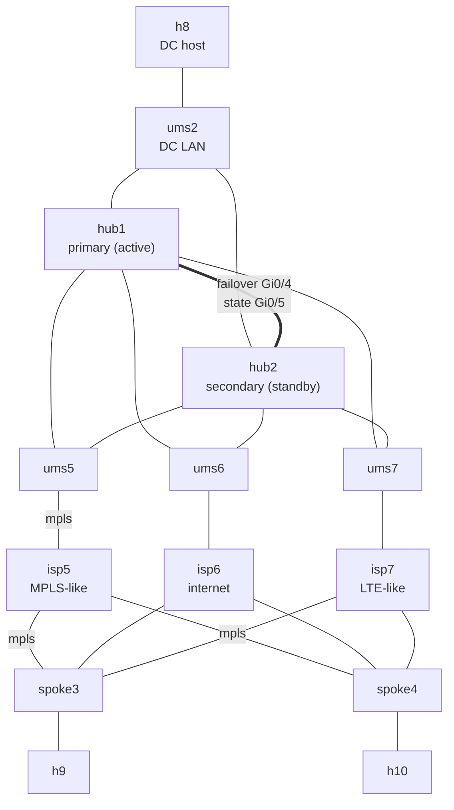

# FTD SD-WAN with an HA hub

> **Status: stable.** Passed all 17 checks twice on CML 2.10.0 with FMC 10.0.1 and FTDv 10.0.0 (2026-10-22): once built with the MCP servers, once with FMC's REST API only. Please [report anything that doesn't work](https://github.com/dr-stutters/cml-cookbook/issues/new?template=recipe-broken.yml).

> **The example values come from the author's lab.** The 198.18.x.x addresses (FMC, management network, FTD management ports) and every password shown on this page are examples from the author's lab or made up for the docs. Replace them with your own. In particular, never use an example password on a real device.

> **This lab connects to your network.** An external connector bridges the FTDs' management ports out of CML so they can reach your FMC. Use a lab network, never an untrusted one, and pick a strong `admin_password`.

Secure Firewall SD-WAN where the hub is a high-availability pair. hub1 and hub2 form an active/standby FTD HA pair, and FMC's SD-WAN wizard joins the pair to the topology as a single hub. Each of the two spokes keeps one IPsec tunnel and one iBGP session to the pair. The pair shares its addresses: the active unit answers on them, and when it fails the standby takes them over. The spokes then build their tunnels and BGP sessions again to the same addresses, so a failover costs tens of seconds of traffic, not minutes, and nothing on the spokes changes.

It's the third of the FTD SD-WAN recipes, after [`ftd-sdwan-single-hub`](../ftd-sdwan-single-hub/) and [`ftd-sdwan-dual-hub`](../ftd-sdwan-dual-hub/), with the same carriers, ports, addressing scheme and FMC steps. Where `ftd-sdwan-dual-hub` gives the spokes two hubs to choose from, this one makes one hub that doesn't go away.

## Before you start

This recipe assumes you already have:

- **An FMC, 7.6 or later** (tested with 10.0.1), that the management network can reach and that has room for four more devices. The lab doesn't include one.
- **The FMC registered to a Smart Account with Export-Controlled Features enabled.** FMC won't deploy the strong (AES) IPsec encryption the tunnels use without it, and evaluation mode doesn't count.
- **The FTDv image in CML** (tested with 10.0.0, the same version as the FMC or older), and room for 10 licensed nodes. The four FTDv nodes take 8 GB of RAM each, about 37 GB for the whole lab.
- **A management network** the external connector (System Bridge) reaches, with four free addresses and a route to the FMC.
- **One FMC domain for everything.** That's Global on most FMCs. Only if yours has child domains (`Global/<something>`) does it matter: FMC won't register devices in a domain with children, so do everything in one of the child domains (the author's lab uses `Global/mcp-test-leaf`).

## Topology



Every tunnel runs over mpls, from each spoke to the pair's active unit. Both hubs sit on a shared segment per carrier (ums5–ums7) and on the DC LAN, so whichever unit is active answers on the same addresses. The FTDs' management ports (not drawn) share `ums`, which `ext` bridges to your network.

| Node | Image | Role | Licensed |
|---|---|---|---|
| hub1 | ftdv | SD-WAN hub, primary unit of the HA pair | yes |
| hub2 | ftdv | SD-WAN hub, secondary unit of the HA pair | yes |
| spoke3, spoke4 | ftdv | Branches with a tunnel to the hub pair | yes |
| isp5 | iol-xe | MPLS-like carrier | yes |
| isp6 | iol-xe | Internet carrier (built and routed, no tunnels) | yes |
| isp7 | iol-xe | LTE-like carrier (built and routed, no tunnels) | yes |
| h8 | alpine | Host on the DC LAN | yes |
| h9, h10 | alpine | Hosts on the branch LANs | yes |
| ums5, ums6, ums7 | unmanaged_switch | The hub pair's segment on each carrier | no |
| ums2 | unmanaged_switch | The DC LAN both hubs share | no |
| ums | unmanaged_switch | Management segment | no |
| ext | external_connector | Bridges management out of CML (System Bridge) | no |

10 licensed nodes, so it needs CML's `personal` tier or bigger. The FTDv image isn't on the reference platform ISO. Plan for **15–30 minutes** before the FTDs finish booting.

Every FTD uses the same ports, which CML calls GigabitEthernet0/x and FMC calls Ethernet0/x:

| Port | Name in FMC | Zone | Connects to |
|---|---|---|---|
| Management0/0 | (management) | | ums |
| GigabitEthernet0/0 | mpls | sdwan-ha-wan | isp5 (the hubs through ums5) |
| GigabitEthernet0/1 | inet | sdwan-ha-wan | isp6 (the hubs through ums6) |
| GigabitEthernet0/2 | lte | sdwan-ha-wan | isp7 (the hubs through ums7) |
| GigabitEthernet0/3 | inside | sdwan-ha-inside | the DC LAN (hubs) or the site's host (spokes) |
| GigabitEthernet0/4 | sdwan-ha-fover | | hubs only: the HA failover link |
| GigabitEthernet0/5 | sdwan-ha-state | | hubs only: the HA state link |

## Addressing

The same scheme as the other FTD SD-WAN recipes: each carrier owns `10.C.0.0/16` (C is its node number). The link from carrier C to spoke N is `10.C.N.0/24`, with the spoke at `.N` and the carrier at `.C`. The hub pair shares `10.C.1.0/24` with the carrier: the active unit is `.1` and the standby `.2`.

| | mpls (isp5) | inet (isp6) | lte (isp7) | inside |
|---|---|---|---|---|
| hub pair, active | 10.5.1.1/24 | 10.6.1.1/24 | 10.7.1.1/24 | 172.16.1.1/24 (DC LAN) |
| hub pair, standby | 10.5.1.2 | 10.6.1.2 | 10.7.1.2 | 172.16.1.2 |
| spoke3 | 10.5.3.3/24 | 10.6.3.3/24 | 10.7.3.3/24 | 172.16.3.1/24 |
| spoke4 | 10.5.4.4/24 | 10.6.4.4/24 | 10.7.4.4/24 | 172.16.4.1/24 |

Hosts: h8 172.16.1.8 (default route to the pair's active address, 172.16.1.1), h9 172.16.3.9, h10 172.16.4.10.

| Link | Subnet | hub1 | hub2 |
|---|---|---|---|
| Failover (Gi0/4) | 10.254.1.0/30 | .1 | .2 |
| State (Gi0/5) | 10.254.2.0/30 | .1 | .2 |

Overlay: the pair's tunnel address is 10.255.1.1, from the loopback `sdwan-dvti-lo`, and the spokes get theirs from the pool `sdwan-ha-pool`, 10.255.1.2–.254.

## Inputs

The examples are from the author's lab. Use your own.

| Input | What it is | Example |
|---|---|---|
| `admin_password` | Password for admin on the four FTDs (secret). It must be strong. | `Sdwan#Lab-2026` (made up) |
| `fmc_ip` | Your FMC's management address | `198.18.134.76` |
| `hub1_mgmt_ip` | hub1's Management0/0 address | `198.18.128.232` |
| `hub2_mgmt_ip` | hub2's Management0/0 address | `198.18.128.233` |
| `spoke3_mgmt_ip` | spoke3's Management0/0 address | `198.18.128.234` |
| `spoke4_mgmt_ip` | spoke4's Management0/0 address | `198.18.128.235` |
| `mgmt_mask` | The management network's mask | `255.255.192.0` |
| `mgmt_gateway` | Its default gateway | `198.18.128.1` |
| `mgmt_dns` | A DNS server the FTDs use | `198.18.133.1` |

Other credentials in the lab:

| What | Value |
|---|---|
| FTD console (hub1, hub2, spoke3, spoke4) | `admin` / your `admin_password` |
| IOL carriers (isp5–7) and Alpine hosts (h8–h10) | `cisco` / `cisco` (the cookbook's lab-only login) |
| FTD to FMC registration key | `cookbook` (only used once, inside the lab) |
| Your FMC login | Your own FMC admin or API user, for example `cookbook-api` / `Fmc-Api#Lab-2026` (made up) |

## Build

The carriers and hosts boot fully configured, and each FTD points itself at your FMC from its day-0 config. Everything else happens in FMC after boot.

- **With a saved prompt (recommended):** run [`prompts/ftd-sdwan.md`](../../../prompts/ftd-sdwan.md) (any agent and tools) or [`prompts/ftd-sdwan-mcp.md`](../../../prompts/ftd-sdwan-mcp.md) (cml-mcp-server and fmc-mcp-server) with the topology `ha-hub`. See [prompts/README.md](../../../prompts/README.md).
- **With an AI agent:** ask it to build `ftd-sdwan-ha-hub` from this repo and run its checks. [AGENTS.md](../../../AGENTS.md) tells it how. It needs your FMC's web UI or REST API to do the steps.
- **Import a lab file:** this recipe needs your values, so make the file yourself, then import it in CML (Dashboard → Import) and start it:

  ```bash
  cookbook render ftd-sdwan-ha-hub -o sdwan-ha.yaml --input admin_password='...' --input fmc_ip=198.18.134.76 --input hub1_mgmt_ip=198.18.128.232 --input hub2_mgmt_ip=198.18.128.233 --input spoke3_mgmt_ip=198.18.128.234 --input spoke4_mgmt_ip=198.18.128.235 --input mgmt_mask=255.255.192.0 --input mgmt_gateway=198.18.128.1 --input mgmt_dns=198.18.133.1
  ```

  The file contains your admin password, so keep it private.
- **By hand:** create the nodes and links in [`recipe.yaml`](recipe.yaml), paste each file from [`configs/`](configs/) into its node's config (replacing the `{{ inputs.… }}` values), and start the lab.

Then do the steps in [`recipe.yaml`](recipe.yaml), in order. Each one names the FMC screen and the REST calls:

1. **Prerequisites.** FMC 7.6 or later, Export-Controlled Features on, the domain to use, and nothing named `sdwan-ha-*` yet.
2. **Objects.** Zones `sdwan-ha-wan`, `-inside` and `-overlay`, one network object per carrier, and an access policy `sdwan-ha-acp` with no rules yet.
3. **Register the four FTDs** as `sdwan-ha-hub1`, `-hub2`, `-spoke3` and `-spoke4`, with registration key `cookbook`.
4. **Interfaces and routes** on hub1 and the spokes only. hub2 gets hub1's configuration when the pair forms.
5. **Deploy all four**, hub2 included: FMC won't pair a device with undeployed changes.
6. **The HA pair** `sdwan-ha-hub`: hub1 primary, hub2 secondary, failover link Ethernet0/4 and state link Ethernet0/5, then the standby addresses, and deploy.
7. **The SD-WAN topology** `sdwan-ha`: the pair as the hub with a dynamic VTI over mpls, both spokes on mpls, iBGP in AS 65000.
8. **The access rule** that lets the inside and overlay zones talk.
9. **Deploy the overlay.**

## FMC objects this recipe creates

Everything starts with `sdwan-ha-` (the hub's tunnel interfaces start with `sdwan-dvti`) and lives in one domain.

| Kind | Names |
|---|---|
| Devices | `sdwan-ha-hub1`, `sdwan-ha-hub2`, `sdwan-ha-spoke3`, `sdwan-ha-spoke4` |
| HA pair | `sdwan-ha-hub` (hub1 primary, hub2 secondary) |
| Security zones | `sdwan-ha-wan`, `sdwan-ha-inside`, `sdwan-ha-overlay` |
| Network objects | `sdwan-ha-mpls`, `sdwan-ha-inet`, `sdwan-ha-lte` |
| Access control policy | `sdwan-ha-acp`, with the rule `sdwan-ha-allow-overlay` |
| SD-WAN topology | `sdwan-ha` |
| IPv4 address pool | `sdwan-ha-pool` |
| Hub interfaces | on the pair: dynamic VTI `sdwan-dvti` and loopback `sdwan-dvti-lo` |

## Checks

| Check | What it proves |
|---|---|
| `fmc-export-controlled` | The FMC can deploy strong IPsec (manual) |
| `hub1-registered` … `spoke4-registered` | Each FTD's registration with FMC completed |
| `hub1-interfaces`, `spoke3-interfaces`, `spoke4-interfaces` | The WAN and inside interfaces are up with the addresses FMC deployed |
| `spoke3-underlay-hub` | spoke3 reaches the hub across the MPLS-like carrier |
| `ha-pair-active`, `ha-pair-standby` | hub1 is Active and hub2 is Standby Ready |
| `hub1-ikev2-sas` | The active hub has a tunnel up to each spoke |
| `spoke3-bgp`, `spoke4-bgp` | Each spoke peers with the hub pair |
| `spoke3-route-dc` | spoke3 learns the DC LAN over the overlay |
| `ping-h9-h8`, `ping-h10-h8`, `ping-h9-h10` | Branches reach the DC and each other |

The exact commands and expected output are in [`recipe.yaml`](recipe.yaml). Every check runs on an FTD or an Alpine host, never on the IOL carriers.

## Clean up

Your FMC outlives the lab, so remove what the recipe created, or the next build will collide with it. The saved prompts' `teardown` mode does this for you. If you're deleting the lab as well:

1. Delete the SD-WAN topology `sdwan-ha`.
2. Delete the HA pair `sdwan-ha-hub` from FMC (Devices > Device Management, Delete on the pair, not Break), then the two spokes. Deleting the pair unregisters both hubs. That removes their interfaces, tunnel interfaces, loopbacks and routes with them, so there's nothing to deploy. Over REST, do one at a time: a delete can time out and still complete, so list the devices again before retrying.
3. Delete the pool `sdwan-ha-pool` (Objects > Address Pools), the access control policy `sdwan-ha-acp`, the three network objects and the three zones.
4. Stop and delete the lab in CML.

Don't stop the lab before deleting the pair from FMC. FMC can't break or delete an HA pair whose units are offline while a pair job is still running, and the record then stays stuck.

## Drills

Failover exercises for a finished build. The saved prompts' `drill` mode runs them. Do one at a time, and put the lab back the way it was after each one.

1. **Switch the active unit.**
   - On h9, run `ping -c 120 172.16.1.8`.
   - While it runs, switch the pair in FMC (Devices > Device Management, the pair's menu, Switch Active Peer), or over REST with PUT on the pair with action SWITCH.
   - `show failover` on hub2 now says Secondary - Active, with hub1 Primary - Standby Ready. The dynamic VTI's tunnels and the BGP sessions on them aren't carried over: the spokes build new IKEv2 SAs to hub2 and their BGP session to 10.255.1.1 starts again (its Up/Down time resets). In the test run that cost about 26 seconds of pings going over, and 14 coming back.
   - Put it back: switch again, so hub1 is active and `ha-pair-active` passes.
2. **Active unit failure.**
   - On h9, run `ping -c 180 172.16.1.8`.
   - While it runs, stop hub1 in CML. hub2 notices when hub1's hellos stop on the failover link (the hold time is 15 seconds) and takes over, and `show failover` on hub2 says Primary - Failed.
   - Count the lost pings. In the test run, about 50 seconds: the hold time, then the spokes rebuilding their tunnels and BGP sessions to hub2.
   - Put it back: start hub1. It rejoins as Standby Ready once it has booted (about 8 minutes in the test run; plan for up to 30). Switch the pair so hub1 is active again. FMC 10.0.1 answered that switch over REST with an HTTP 500 "Error while fetching metadata from backend" and still switched, so check `show failover` before retrying.

## Things to try

- **Pull a monitored interface.** Take hub1 GigabitEthernet0/3 ↔ ums2 down in CML. FTDv keeps the port up, so interface monitoring doesn't see it: the pair doesn't fail over and the DC LAN drops off. Compare that with stopping the node.
- **Add backup WAN tunnels over inet.** Combine this with `ftd-sdwan-single-hub`'s second topology on the pair.
- **Read what FMC built.** `show running-config failover` and `show running-config router bgp` on hub1.
