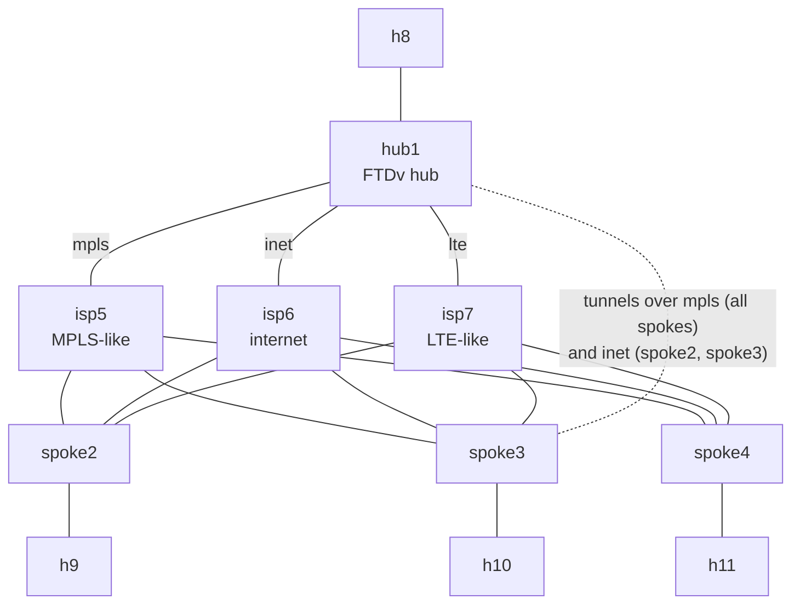

# FTD SD-WAN with one hub

> **Status: stable.** Passed all 22 checks twice on CML 2.10.0 with FMC 10.0.1 and FTDv 10.0.0 (2026-10-21): once built with the MCP servers, once with FMC's REST API only. Please [report anything that doesn't work](https://github.com/dr-stutters/cml-cookbook/issues/new?template=recipe-broken.yml).

> **The example values come from the author's lab.** The 198.18.x.x addresses (FMC, management network, FTD management ports) and every password shown on this page are examples from the author's lab or made up for the docs. Replace them with your own. In particular, never use an example password on a real device.

> **This lab connects to your network.** An external connector bridges the FTDs' management ports out of CML so they can reach your FMC. Use a lab network, never an untrusted one, and pick a strong `admin_password`.

Secure Firewall SD-WAN in one lab: a hub and three branch firewalls on FTDv, three simulated carriers between them, and a host behind each firewall. Your FMC builds the SD-WAN with its SD-WAN wizard: an IPsec tunnel from every spoke to the hub over virtual tunnel interfaces (a dynamic VTI on the hub, a static VTI on each spoke), with iBGP over the tunnels that FMC generates for you. Two of the spokes also get a backup tunnel over a second carrier.

Run it to see what FMC's SD-WAN wizard builds on the devices (`show crypto ikev2 sa`, `show bgp summary`, `show route bgp`), to try WAN failover by pulling a carrier link, or as a starting point for app-aware routing and path monitoring.

## Before you start

This recipe assumes you already have:

- **An FMC, 7.6 or later** (tested with 10.0.1), that the management network can reach and that has room for four more devices. The lab doesn't include one: an FMCv needs 32 GB of RAM on its own.
- **The FMC registered to a Smart Account with Export-Controlled Features enabled.** FMC won't deploy the strong (AES) IPsec encryption the tunnels use without it, and evaluation mode doesn't count.
- **The FTDv image in CML** (tested with 10.0.0, the same version as the FMC or older), and room for 11 licensed nodes. The four FTDv nodes take 8 GB of RAM each, about 37 GB for the whole lab.
- **A management network** the external connector (System Bridge) reaches, with four free addresses and a route to the FMC.
- **One FMC domain for everything.** That's Global on most FMCs. Only if yours has child domains (`Global/<something>`) does it matter: FMC won't register devices in a domain with children, so do everything in one of the child domains (the author's lab uses `Global/mcp-test-leaf`).

## Topology



The FTDs' management ports (not drawn) share `ums`, which `ext` bridges to your network.

| Node | Image | Role | Licensed |
|---|---|---|---|
| hub1 | ftdv | SD-WAN hub | yes |
| spoke2, spoke3 | ftdv | Branches with a primary tunnel over mpls and a backup over inet | yes |
| spoke4 | ftdv | Branch with a single tunnel over mpls | yes |
| isp5 | iol-xe | MPLS-like carrier | yes |
| isp6 | iol-xe | Internet carrier | yes |
| isp7 | iol-xe | LTE-like carrier (built and routed, no tunnel uses it) | yes |
| h8, h9, h10, h11 | alpine | Alpine Linux hosts on the four inside LANs | yes |
| ums | unmanaged_switch | Management segment | no |
| ext | external_connector | Bridges management out of CML (System Bridge) | no |

11 licensed nodes, so it needs CML's `personal` tier or bigger. The FTDv image isn't on the reference platform ISO. Plan for **15–30 minutes** before the FTDs finish booting.

Every FTD uses the same ports, which CML calls GigabitEthernet0/x and FMC calls Ethernet0/x:

| Port | Name in FMC | Zone | Connects to |
|---|---|---|---|
| Management0/0 | (management) | | ums |
| GigabitEthernet0/0 | mpls | sdwan-single-wan | isp5 |
| GigabitEthernet0/1 | inet | sdwan-single-wan | isp6 |
| GigabitEthernet0/2 | lte | sdwan-single-wan | isp7 |
| GigabitEthernet0/3 | inside | sdwan-single-inside | the site's host |

## Addressing

Each carrier owns a /16, `10.C.0.0/16`, where C is the carrier's node number (isp5, isp6, isp7). The link from carrier C to the FTD numbered N is `10.C.N.0/24`: the FTD is `.N` and the carrier is `.C`. That turns the cookbook's usual `10.X.Y` link numbering around (carrier first). It means every FTD needs only one static route per carrier, which is how a real provider network looks.

| | mpls (isp5) | inet (isp6) | lte (isp7) | inside LAN | host |
|---|---|---|---|---|---|
| hub1 | 10.5.1.1/24 | 10.6.1.1/24 | 10.7.1.1/24 | 172.16.1.1/24 | h8 172.16.1.8 |
| spoke2 | 10.5.2.2/24 | 10.6.2.2/24 | 10.7.2.2/24 | 172.16.2.1/24 | h9 172.16.2.9 |
| spoke3 | 10.5.3.3/24 | 10.6.3.3/24 | 10.7.3.3/24 | 172.16.3.1/24 | h10 172.16.3.10 |
| spoke4 | 10.5.4.4/24 | 10.6.4.4/24 | 10.7.4.4/24 | 172.16.4.1/24 | h11 172.16.4.11 |

The carriers are `.5`, `.6` and `.7` on their links and only know their connected networks. The overlay uses two /24s:

| Overlay | hub1 tunnel address | Spoke tunnel pool | Spokes |
|---|---|---|---|
| `sdwan-single` over mpls | 10.255.1.1 (loopback `sdwan-dvti-lo`) | 10.255.1.2–.254 | spoke2, spoke3, spoke4 |
| `sdwan-single-wan2` over inet | 10.255.2.1 (loopback `sdwan-dvti-wan2-lo`) | 10.255.2.2–.254 | spoke2, spoke3 |

## Inputs

The examples are from the author's lab. Use your own.

| Input | What it is | Example |
|---|---|---|
| `admin_password` | Password for admin on the four FTDs (secret). It must be strong. | `Sdwan#Lab-2026` (made up) |
| `fmc_ip` | Your FMC's management address | `198.18.134.76` |
| `hub1_mgmt_ip` | hub1's Management0/0 address | `198.18.128.224` |
| `spoke2_mgmt_ip` | spoke2's Management0/0 address | `198.18.128.225` |
| `spoke3_mgmt_ip` | spoke3's Management0/0 address | `198.18.128.226` |
| `spoke4_mgmt_ip` | spoke4's Management0/0 address | `198.18.128.227` |
| `mgmt_mask` | The management network's mask | `255.255.192.0` |
| `mgmt_gateway` | Its default gateway | `198.18.128.1` |
| `mgmt_dns` | A DNS server the FTDs use | `198.18.133.1` |

Other credentials in the lab:

| What | Value |
|---|---|
| FTD console (hub1, spoke2–4) | `admin` / your `admin_password` |
| IOL carriers (isp5–7) and Alpine hosts (h8–h11) | `cisco` / `cisco` (the cookbook's lab-only login) |
| FTD to FMC registration key | `cookbook` (only used once, inside the lab) |
| Your FMC login | Your own FMC admin or API user, for example `cookbook-api` / `Fmc-Api#Lab-2026` (made up) |

## Build

The carriers and hosts boot fully configured, and each FTD points itself at your FMC from its day-0 config. Everything else happens in FMC after boot: an FTD managed by FMC takes its configuration from FMC, not from day-0 config.

- **With a saved prompt (recommended):** [`prompts/ftd-sdwan.md`](../../../prompts/ftd-sdwan.md) works with any agent and tools. [`prompts/ftd-sdwan-mcp.md`](../../../prompts/ftd-sdwan-mcp.md) uses [cml-mcp-server](https://github.com/dr-stutters/cml-mcp-server) and [fmc-mcp-server](https://github.com/dr-stutters/fmc-mcp-server). Both can build, check, run failover drills and tear down. See [prompts/README.md](../../../prompts/README.md).
- **With an AI agent:** ask it to build `ftd-sdwan-single-hub` from this repo and run its checks. [AGENTS.md](../../../AGENTS.md) tells it how. It will ask you for the inputs, and it needs your FMC's web UI or REST API to do the steps.
- **Import a lab file:** this recipe needs your values, so its releases don't include one. Make it yourself, then import it in CML (Dashboard → Import) and start it:

  ```bash
  cookbook render ftd-sdwan-single-hub -o sdwan-lab.yaml --input admin_password='...' --input fmc_ip=198.18.134.76 --input hub1_mgmt_ip=198.18.128.224 --input spoke2_mgmt_ip=198.18.128.225 --input spoke3_mgmt_ip=198.18.128.226 --input spoke4_mgmt_ip=198.18.128.227 --input mgmt_mask=255.255.192.0 --input mgmt_gateway=198.18.128.1 --input mgmt_dns=198.18.133.1
  ```

  The file contains your admin password, so keep it private.
- **By hand:** create the nodes and links in [`recipe.yaml`](recipe.yaml), paste each file from [`configs/`](configs/) into its node's config (replacing the `{{ inputs.… }}` values), and start the lab.

Then do the steps in [`recipe.yaml`](recipe.yaml), in order. Each one names the FMC screen and the REST call:

1. **Prerequisites.** FMC 7.6 or later, Export-Controlled Features on, and nothing named `sdwan-single-*` yet.
2. **Objects.** Zones `sdwan-single-wan`, `-inside` and `-overlay`, one network object per carrier, and an access policy `sdwan-single-acp` with no rules yet.
3. **Register the four FTDs** as `sdwan-single-hub1` … `sdwan-single-spoke4`, with registration key `cookbook`.
4. **Interfaces and routes.** The addresses in the table above, and one static route per carrier.
5. **Deploy the underlay.**
6. **The SD-WAN topology** `sdwan-single`: hub1's dynamic VTI over mpls, every spoke on mpls, and iBGP in AS 65000.
7. **Backup tunnels.** A second topology, `sdwan-single-wan2`, on the same hub over inet, for spoke2 and spoke3. On FMC 10.0.1 this is how a spoke gets a second WAN tunnel.
8. **The access rule** that lets the inside and overlay zones talk.
9. **Deploy the overlay.**

## FMC objects this recipe creates

Everything starts with `sdwan-single-` (the hub's tunnel interfaces start with `sdwan-dvti`) and lives in one domain, so you can find it all and clean it up.

| Kind | Names |
|---|---|
| Devices | `sdwan-single-hub1`, `sdwan-single-spoke2`, `sdwan-single-spoke3`, `sdwan-single-spoke4` |
| Security zones | `sdwan-single-wan`, `sdwan-single-inside`, `sdwan-single-overlay` |
| Network objects | `sdwan-single-mpls`, `sdwan-single-inet`, `sdwan-single-lte` |
| Access control policy | `sdwan-single-acp`, with the rule `sdwan-single-allow-overlay` |
| SD-WAN topologies | `sdwan-single`, `sdwan-single-wan2` |
| IPv4 address pools | `sdwan-single-pool`, `sdwan-single-wan2-pool` |
| hub1 interfaces | dynamic VTIs `sdwan-dvti` and `sdwan-dvti-wan2`, loopbacks `sdwan-dvti-lo` and `sdwan-dvti-wan2-lo` |

## Checks

| Check | What it proves |
|---|---|
| `fmc-export-controlled` | The FMC can deploy strong IPsec (manual) |
| `hub1-registered`, `spoke2-registered`, `spoke3-registered`, `spoke4-registered` | Each FTD's registration with FMC completed |
| `hub1-interfaces` … `spoke4-interfaces` | The WAN and inside interfaces are up with the addresses FMC deployed |
| `spoke2-underlay-mpls`, `-inet`, `-lte` | spoke2 reaches hub1 across each carrier |
| `hub1-ikev2-sas` | All five tunnels are up: three over mpls, two over inet |
| `hub1-bgp` | hub1 has an iBGP session over every tunnel |
| `spoke2-bgp` | spoke2 peers with hub1 over both of its tunnels |
| `spoke4-bgp`, `spoke4-bgp-routes` | spoke4 peers with hub1 and learns every other site's LAN through it |
| `ping-h9-h8` … `ping-h10-h11` | Every host reaches every other host, hub to spoke and spoke to spoke through the hub |

The exact commands and expected output are in [`recipe.yaml`](recipe.yaml). Every check runs on an FTD or an Alpine host, never on the IOL carriers, so they still work on CML controllers where Docker IOL consoles stay silent.

## Clean up

Your FMC outlives the lab, so remove what the recipe created, or the next build will collide with it. The saved prompts' `teardown` mode does this for you. If you're deleting the lab as well:

1. Delete the SD-WAN topologies `sdwan-single` and `sdwan-single-wan2`.
2. Delete the four devices from FMC (Devices > Device Management). That removes their interfaces, tunnel interfaces, loopbacks and routes with them, so there's nothing to deploy. Over REST, do one device at a time: a delete can time out and still complete, so list the devices again before retrying.
3. Delete the pools `sdwan-single-pool` and `sdwan-single-wan2-pool` (Objects > Address Pools), the access control policy `sdwan-single-acp`, the three network objects and the three zones.
4. Stop and delete the lab in CML.

If you keep the FTDs, delete the topologies and deploy, then delete hub1's `sdwan-dvti`, `sdwan-dvti-wan2`, `sdwan-dvti-lo` and `sdwan-dvti-wan2-lo` and deploy again, before deleting the pools. Run 1's teardown took that longer route; run 2's took the short one.

## Drills

Failover exercises for a finished build. The saved prompts' `drill` mode runs them. Do one at a time, and put the lab back the way it was after each one. The results below are from the first passing run (2026-10-21).

One thing to know first: when CML takes a link down, FTDv keeps its port up/up. So an FTD finds out that a WAN is dead from IKE and BGP timing out, not from the interface going down.

1. **WAN failover on spoke2.**
   - On h9, run `ping -c 60 172.16.1.8`.
   - While it runs, take the link spoke2 GigabitEthernet0/0 ↔ isp5 Ethernet0/2 down in CML.
   - Count the lost pings. With multipath on, each flow is hashed onto one tunnel: a flow already on inet loses nothing. A flow on mpls stalls until spoke2 drops the dead tunnel.
   - In our run, h9's pings were on inet and lost none. spoke2 dropped the mpls tunnel and its BGP session to 10.255.1.1 about 2 minutes after the link went down, and kept 10.255.2.1.
   - Bring the link back up. The mpls BGP session returned within 46 seconds, and `spoke2-bgp` passed again.
2. **No backup on spoke4.**
   - Take spoke4 GigabitEthernet0/0 ↔ isp5 Ethernet1/0 down. h11 loses every other site (`ping-h11-h8` fails, 10 of 10 lost), because spoke4 has only one tunnel.
   - Bring the link back up, and time how long `ping-h11-h8` takes to pass again: 53 seconds in our run.
3. **Brownout on spoke2's mpls link.**
   - Apply CML's `brownout` link scenario to spoke2 ↔ isp5: 150 ms each way with 50 ms of jitter, and 20% loss each way (about 36% round trip).
   - On spoke2, `ping 10.5.1.1` crosses the degraded mpls underlay (about 300 ms, some loss), while `ping 10.6.1.1` over inet stays at 1 ms.
   - The tunnel and its BGP session stay up, so BGP keeps sending some flows over mpls, and those suffer. In our run h9's flows to every site happened to be on inet and stayed clean.
   - This is the problem path monitoring and app-aware routing solve (see below). FMC's path metrics (Overview > SD-WAN Summary) show it about 5 minutes later.
   - Remove the conditioning.

## Things to try

- **App-aware routing.** Turn on path monitoring on the spokes' WAN interfaces and steer an application by jitter or loss. On FTDv 10.0 the policy-based route followed the routing table in our tests, so check `show route-map` and `packet-tracer` before trusting it.
- **OSPF instead of iBGP.** Build the topology with BGP off and run OSPF over the tunnels. On FMC 10.0.1 that only works when each spoke's tunnel borrows a /32 from a loopback, so both ends of every tunnel are unnumbered like the hub's.
- **Use the LTE carrier.** Move spoke4's tunnel to lte, or give it a backup over lte with a third topology on hub1.
- **Read what FMC built.** `show running-config interface`, `show running-config router bgp` and `show crypto ipsec sa` on hub1 and a spoke.
