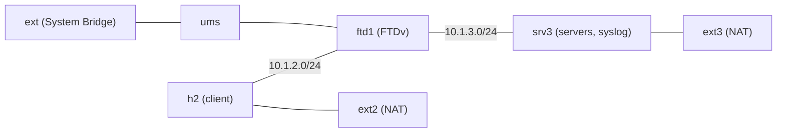

# FTD TLS cipher policy

> **Status: draft.** Every check passed on a real CML (CML 2.10, FTDv 10.0.0, FMC 10.0.1) with h2 and srv3 built fresh from this version. Expect rough edges, and please [report anything that doesn't work](https://github.com/dr-stutters/cml-cookbook/issues/new?template=recipe-broken.yml).

> **Bridged lab.** ftd1's management port is bridged to your network through the `ext` external connector so it can reach your FMC. The `inputs` examples (`198.18.x.x`) are a real lab's values from the benchmarking range. h2 and srv3 use the lab-only `cisco`/`cisco` login and are only reachable on their consoles and through ftd1. Their second port is CML NAT, which goes out to the internet only.

Customers ask three things about TLS through a firewall:
1. Can it tell me which TLS version and cipher my traffic uses?
2. Can it block the weak ones?
3. Can it "step up" a weak cipher to a stronger one?

This lab answers all three on an FTDv managed by an FMC you already have.

h2 is the TLS client. srv3 runs six `openssl s_server` instances, each pinning one TLS profile, and is also ftd1's syslog collector.
- `tls-matrix` on h2 runs ten test cases. Each row shows the protocol and cipher h2 negotiated, the protocol and cipher srv3 negotiated, and who issued the certificate h2 received.
- `tls-events` on srv3 prints what ftd1 logged for each session.

## What the lab shows

| Question | Answer from the lab |
|---|---|
| Does FTD log the TLS version and cipher? | Only once a decryption policy is linked to the access policy. A policy with no rules and the default action Do not decrypt is enough. Without one, the connection event has only `SSLServerName`. With one, every TLS event also carries `SSLVersion`, `SSLCipherSuite`, `SSLActualAction`, `SSLRuleName`, `SSLFlowStatus`, `SSLServerCertStatus` and `SSLCertificate`. Nothing is decrypted, and RC4 and 3DES sessions are logged as such. |
| Can it block old versions and weak ciphers? | Yes, with Block with reset rules in the decryption policy: a Version condition (SSL 3.0, TLS 1.0, TLS 1.1) and a Cipher Suite condition. The cipher suite condition matches the suite the **server chose**, so a client that offered a strong suite first is still blocked when the server picks a weak one. Each blocked event names the rule. |
| Can it step up a weak cipher? | Not as a feature. With Decrypt - Resign, FTD gave the client the same suite the server chose in every case this lab tried (the two legs never differed). It does remove suites it can't decrypt (RC4) from the ClientHello it forwards. When the client also offered something stronger, the server falls back to it: RC4 became ECDHE-RSA-AES128-GCM-SHA256 here. Suites FTD can decrypt (3DES, RSA-CBC) are left in and stay weak, so block them. An RC4-only client is reset by the cipher block rule or by the Unsupported Cipher Suite action (runs have logged both); with the resign rule above the block rules, only that action stops it, and at its default it lets RC4 through undecrypted. |
| Does rule order matter? | Yes. A Decrypt - Resign rule above the cipher block rule lets decryptable weak suites through, decrypted. Put the block rules first. With the resign rule below them, RC4 is still stepped up. |

## Topology

| Node | Image | Role |
|---|---|---|
| ftd1 | ftdv | Firewall between h2 and srv3, registered to your FMC (display name `tls-cipher-ftd1`) |
| h2 | alpine | TLS client: OpenSSL 3, plus OpenSSL 1.1.1w built at boot for RC4 and 3DES; `tls-matrix` |
| srv3 | alpine | Six TLS servers and ftd1's syslog collector (`/var/log/ftd.log`); `tls-events` |
| ext, ums | external connector, unmanaged switch | ftd1's management network |
| ext2, ext3 | external connector (NAT) | Package downloads for h2 and srv3 |

Three licensed nodes (ftd1, h2, srv3) and about 10 GB of RAM. FTDv isn't on the reference platform ISO.

### srv3's servers and h2's test cases

| Port | srv3 profile | tls-matrix cases (h2 offers) |
|---|---|---|
| 443 | TLS 1.3, or TLS 1.2 with ECDHE and AES-GCM/ChaCha20 | `modern13` (default), `modern12` (TLS 1.2 only) |
| 8443 | TLS 1.0 and 1.1 only | `tls10`, `tls11` |
| 9443 | TLS 1.2, `AES128-SHA` only (RSA key exchange, CBC, SHA-1) | `rsa-cbc` |
| 10443 | TLS 1.2, prefers `AES128-SHA` over ECDHE-GCM | `pref-weak` (offers ECDHE-GCM first) |
| 11443 | TLS 1.2, prefers 3DES over ECDHE-GCM (OpenSSL 1.1.1w) | `pref-3des`, `only-3des` |
| 12443 | TLS 1.2, prefers RC4 over ECDHE-GCM (OpenSSL 1.1.1w) | `pref-rc4`, `only-rc4` |

## Addressing

| Link | Subnet | Notes |
|---|---|---|
| ftd1 Gi0/1 (inside) to h2 eth0 | 10.1.2.0/24 | ftd1 .1, h2 .2. h2 routes only 10.1.3.0/24 through ftd1. |
| ftd1 Gi0/0 (outside) to srv3 eth0 | 10.1.3.0/24 | ftd1 .1, srv3 .3. srv3 routes only 10.1.2.0/24 through ftd1. |
| h2 eth1, srv3 eth1 | CML NAT (DHCP) | Default route, used only for downloads |

## Build

ftd1 registers itself to your FMC at day 0. h2 and srv3 configure themselves and build OpenSSL 1.1.1w in the background (5-10 minutes; `tls-lab-status` shows progress). Everything on the FMC side is a `manual` step, because the recipe can't reach your FMC: zones, the access policy, registration, interfaces, syslog, the decryption policy and its rules. An agent with an FMC API or the FMC MCP server can do those steps itself.

- **With an AI agent:** ask it to build `ftd-tls-cipher-policy` from this repo and run its checks. [AGENTS.md](../../../AGENTS.md) tells it how.
- **Import the lab file:** download `ftd-tls-cipher-policy-v<version>.yaml` from the recipe's [latest release](https://github.com/dr-stutters/cml-cookbook/releases?q=ftd-tls-cipher-policy), import it in CML (Dashboard → Import) and start it. Or make it yourself with `cookbook render ftd-tls-cipher-policy -o lab.yaml`, adding `--input` for each input.
- **By hand:** create the nodes and links above in the CML UI, paste each file from [`configs/`](configs/) into the node's config before starting it, then start the lab.

Then follow the steps in [`recipe.yaml`](recipe.yaml) in order. Run `tls-matrix` on h2 and `tls-events` on srv3 after each deploy.

**Rebuilding h2 or srv3 while ftd1 keeps running:** a wiped node comes back with new MAC addresses, so each host pings ftd1 once at boot and ftd1 replaces its old ARP entry straight away.

## Checks

| Check | What it proves |
|---|---|
| `h2-ready`, `srv3-ready` | Both hosts finished their setup; srv3's six servers and the collector are listening |
| `ftd1-registered` | ftd1 is registered to your FMC |
| `h2-reaches-srv3`, `h2-modern-tls13` | Traffic and a TLS 1.3 session pass ftd1 |
| `srv3-sees-tls-fields` | ftd1's connection events carry the TLS version and cipher suite |
| `h2-old-tls-blocked` | TLS 1.0 and 1.1 are reset |
| `h2-weak-ciphers-blocked` | Weak suites are reset, including when the server picked one over a strong offer |
| `h2-strong-allowed` | TLS 1.3 and TLS 1.2 ECDHE-GCM still pass |
| `h2-rc4-stepped-up` | Decrypt - Resign turns an RC4-preferring session into ECDHE-GCM on both legs |
| `h2-only-rc4-blocked` | An RC4-only session is reset (by `block-weak-ciphers` or the Unsupported Cipher Suite action) |
| `h2-3des-still-blocked` | A decryptable weak suite stays blocked with the resign rule below the block rules |

The exact commands and expected output are in [`recipe.yaml`](recipe.yaml).

## Things to try

- Move `resign-stepup` above the block rules, deploy and run `tls-matrix`: pref-weak, pref-3des and only-3des now pass, decrypted.
- Move `resign-stepup` above the block rules and set Unsupported Cipher Suite back to "Inherit default action": `only-rc4` now passes undecrypted with RC4 (`tls-events` shows flow status "Unsupported Cipher Suite").
- `tls-events -v` prints every SSL field. Compare `SSLExpectedAction` with `SSLActualAction` on a session FTD wanted to decrypt but couldn't.
- Capture `h2-ftd1` and `ftd1-srv3` while running `tls-matrix pref-rc4`, and compare the two ClientHellos. The lab infers the stripping from srv3's choice; a capture shows it directly (not yet done on a run).
