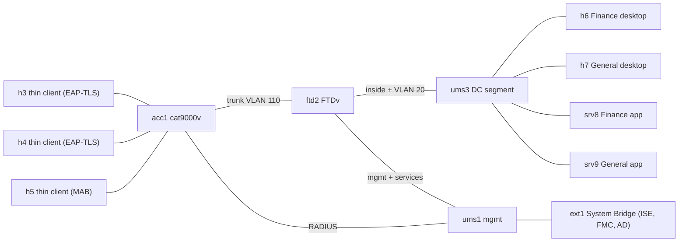

# Thin client NAC with per-user VDI VPN

> **Status: draft.** Not yet built from this recipe. The design was proven on CML 2.10.0 with ISE 3.5, FMC 10.0.1, FTDv 10.0.0 and cat9000v UADP 17.18.02 (2026-10-31), but in a prototype lab with other node names and addresses, so the recipe as written still needs its first run. Please [report anything that doesn't work](https://github.com/dr-stutters/cml-cookbook/issues/new?template=recipe-broken.yml).

> **Bridged lab.** acc1 and ftd2 are bridged to your network through `ext1` so they can reach ISE and your FMC. The `inputs` examples (`198.18.x.x`) are a real lab's values from the benchmarking range. The hosts use the lab-only `cisco`/`cisco` login and are reachable only on their consoles and through ftd2. Their second port is CML NAT, which goes out to the internet only.

A thin client is a device, and the person on the VDI desktop behind it is a user. This lab puts each under its own control:

1. **Device, on the wire.** The thin client authenticates on its access port: EAP-TLS with a machine certificate from your CA, or MAB for one with no supplicant. ISE's answer is a dACL that allows only RDP to the desktops (and DHCP). The thin client can't reach anything else, the apps included.
2. **User, inside the desktop.** The VDI desktop can't reach the apps on its own. The user starts Cisco Secure Client inside the desktop session, and ISE authenticates them against AD and returns two things: a group policy (through the RADIUS `Class` attribute) and an SGT. ftd2's access rules match the SGT, so a Finance user reaches both apps and a General user reaches only the general one.

## What the lab shows

| Question | Answer from the lab |
|---|---|
| Can a thin client be limited to RDP? | Yes. ISE's dACL `TC-RDP-ONLY` on the access port allows DHCP and TCP 3389 to the desktop subnet and nothing else. ftd2 backs it up with a zone rule that allows only RDP from the thin-client VLAN. |
| What if a thin client has no supplicant? | IBNS 2.0 on acc1 falls back to MAB. ISE allows only MACs in the endpoint group `TC_Thin_Clients_MAB`, with the same dACL. |
| Can access follow the user, not the desktop? | Yes. The same desktop gets nothing without the VPN, and with it gets whatever the user's AD group earns. ftd2 tags the VPN session with the SGT from ISE's Access-Accept (`cts:security-group-tag`), and the access rules match the SGT. The group policy comes from `Class` (GP-Finance or GP-General), so the connection profile needs only `DfltGrpPolicy`. |
| Does the VPN break RDP to the desktop? | Not with a split tunnel. The group policies tunnel only the app subnet (172.16.30.0/24). With a full tunnel, the RDP replies go into the tunnel and the thin client's session drops. |
| Can ISE end a user's session? | Yes, with a CoA disconnect. ftd2 must have its RADIUS server pinned to the services interface: with route lookup, it silently ignores ISE's Disconnect-Request. |

### Limits

- **One user per desktop.** A multi-session host (RDSH, AVD multi-session) has one machine-level tunnel, which can't carry a different SGT for each user.
- **No link between thin client and user in policy.** ISE knows both, but in two separate sessions. Joining them, for example in a SIEM, is after-the-fact reporting: the thin client's address shows up as the RDP client in the desktop's xrdp log, and the desktop's address is the VPN session's `Calling-Station-ID`.
- **The Linux Secure Client doesn't treat SSH as a remote session.** With the default `LinuxVPNEstablishment=LocalUsersOnly`, an SSH-started VPN still connected in testing. The recipe's local profile sets `AllowRemoteUsers` so xrdp sessions work.

## Topology

| Node | Image | Role |
|---|---|---|
| acc1 | cat9000v-uadp | Access switch: IBNS 2.0, 802.1X then MAB, closed mode, RADIUS and CoA from Gi1/0/24 |
| ftd2 | ftdv | Gateway for every segment, DHCP for the thin clients, Secure Client headend, SGT rules |
| h3, h4 | ubuntu | Thin clients: wpa_supplicant (EAP-TLS) and FreeRDP |
| h5 | alpine | Thin client with no supplicant (MAB) |
| h6, h7 | ubuntu (4 GB) | VDI desktops: xrdp, XFCE, Secure Client |
| srv8, srv9 | alpine | Apps: one web page each |
| ums1, ums2, ums3 | unmanaged_switch | Management, NAT and DC segments |
| ext1, ext2 | external_connector | System Bridge to your network; CML NAT for packages |

10 licensed nodes. FTDv isn't on the reference platform ISO; everything else is.

The desktops sit on an unmanaged switch with VLAN 20 tagged in the guest, rather than on a second cat9000v port, and ftd2 routes everything. A cat9000v in CML only forwards on links that existed when it booted, and data ports re-cabled while it ran learned MACs but never forwarded. So build the lab with every link in place before acc1 starts, and reboot acc1 after any re-cabling.

## Addressing

| Segment | Subnet | Notes |
|---|---|---|
| Thin clients (VLAN 110) | 172.16.110.0/24 | ftd2 `thinclients` .1 is gateway and DHCP server (.100-.199) |
| Desktops (VLAN 20) | 172.16.20.0/24 | ftd2 `outside` .1 is gateway and VPN headend; h6 .6, h7 .7 |
| Apps | 172.16.30.0/24 | ftd2 `inside` .1; srv8 .8, srv9 .9 |
| VPN pool | 172.16.40.0/24 | .10-.200 |
| Management | your network | acc1, ftd2 management and ftd2 services (inputs) |

## Build

The nodes boot with their day-0 configs, but most of the lab is in ISE, the FMC and your CA, which a day-0 config can't reach. The steps in [`recipe.yaml`](recipe.yaml), in order:

1. `hosts-ready`: wait for the hosts' package installs.
2. `fmc-register`: register ftd2 (Essentials and Secure Client Premier licences, in a leaf domain).
3. `fmc-interfaces`: zones, interfaces and subinterfaces, DHCP, the RDP and block rules.
4. `ise-base`: network devices, SGTs, AD groups, the dACL.
5. `ise-wired-policy`: the `TC-Wired` policy set (EAP-TLS and MAB).
6. `thin-client-auth`: sign h3's and h4's CSRs, start 802.1X, allow h5's MAC.
7. `fmc-ravpn`: certificate, Secure Client package, RADIUS group with CoA, group policies, the SGT rules.
8. `ise-vpn-policy`: the `TC-VDI-VPN` policy set.
9. `desktops-vpn`: install Secure Client on the desktops and connect a Finance and a General user.

Each needs something from outside the lab: an ISE or FMC change, a certificate from your CA, or a Cisco package you download yourself.

- **With an AI agent:** ask it to build `thin-client-nac-vdi` from this repo and run its checks. [AGENTS.md](../../../AGENTS.md) tells it how.
- **Import the lab file:** download `thin-client-nac-vdi-v<version>.yaml` from the recipe's [latest release](https://github.com/dr-stutters/cml-cookbook/releases?q=thin-client-nac-vdi), or make it with `cookbook render thin-client-nac-vdi -o lab.yaml --input name=value ...`, import it in CML (Dashboard → Import) and start it.
- **By hand:** create the nodes and links in [`recipe.yaml`](recipe.yaml) in the CML UI, paste each file from [`configs/`](configs/) into the node's config before starting it (an Ubuntu node's file is its cloud-init user-data), then start the lab.

### Helpers on the hosts

| Command | Where | What it does |
|---|---|---|
| `tc-status` | h3, h4, h6, h7 | Setup state; on thin clients also the 802.1X state and address |
| `sudo tc-dot1x` | h3, h4 | Starts 802.1X on ens2 once `/etc/eaptls/client.pem` and `ca.pem` are there |
| `probe <host> <port>` | h3, h4, h6, h7 | One TCP connect: `open` or `closed` |
| `sudo vdi-vpn-install <deb>` | h6, h7 | Installs the Secure Client vpn package and the local profile |
| `vdi-vpn connect <user>` / `disconnect` / `status` | h6, h7 | Secure Client CLI; asks for the AD password |
| `app-probe` | h6, h7 | HTTP status from srv8 and srv9: 200 reachable, 000 blocked |

## Checks

| Check | What it proves |
|---|---|
| `h3-ready`, `h4-ready`, `h6-ready`, `h7-ready` | The hosts finished their setup |
| `ftd2-registered`, `ftd2-interfaces-up` | ftd2 is in the FMC with its four data addresses |
| `h3-authorized` | h3's supplicant is authorized and got a thin-client address |
| `acc1-eap-tls-sessions` | acc1 authorized h3 and h4 by 802.1X |
| `acc1-mab-session` | acc1 authorized h5 by MAB, with the `TC-RDP-ONLY` dACL |
| `h3-rdp-to-desktops` | A thin client reaches both desktops on RDP |
| `h3-apps-blocked` | ... and nothing else, the apps included |
| `h6-apps-blocked-without-vpn` | A desktop reaches no app without the VPN |
| `ftd2-vpn-sessions-sgt` | Both VPN sessions have the group policy and SGT from ISE |
| `h6-finance-reaches-both-apps` | Finance (SGT 142) reaches srv8 and srv9 |
| `h7-general-reaches-only-srv9` | General (SGT 143) reaches srv9 only |
| `h3-rdp-with-vpn-up` | The split tunnel keeps RDP to the desktops working |
| `ise-coa-disconnect` (manual) | ISE can end a user's VPN session |

The exact commands and expected output are in [`recipe.yaml`](recipe.yaml).

## Things to try

- Change GP-General to a full tunnel and run `h3-rdp-with-vpn-up` again: RDP to h7 breaks while its VPN is up.
- Move the General user into VDI-Finance in AD, reconnect on h7, and `app-probe` shows srv8 too.
- Unplug h3's certificate (`sudo systemctl stop wpa_supplicant-wired@ens2`, then clear the session on acc1): the port falls back to MAB and ISE rejects the unknown MAC.
- Sign in to a desktop for real from a thin client: `xfreerdp /v:172.16.20.6 /u:cisco /p:cisco` (needs a display, for example `xvfb-run`).
