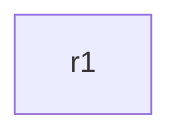

# __RECIPE_TITLE__

> **Status: draft.** Written but not yet tested on a real CML. Expect rough edges, and please [report anything that doesn't work](https://github.com/dr-stutters/cml-cookbook/issues/new?template=recipe-broken.yml).

TODO: what this lab builds, and what someone learns or tests by running it.

## Topology

| Node | Image | Role | Loopback0 |
|---|---|---|---|
| r1 | iol-xe | TODO | 10.255.0.1 |

TODO: licensed node count and whether every image is on the reference platform ISO.

## Addressing

| Link | Subnet | Notes |
|---|---|---|

## Build

TODO: say whether every node boots fully configured. If there are `steps` in `recipe.yaml`, explain here why each one can't be day-0 config.

- **With an AI agent:** ask it to build `__RECIPE_ID__` from this repo and run its checks. [AGENTS.md](../../../AGENTS.md) tells it how.
- **By hand:** create the nodes and links in the table above in the CML UI, paste each file from [`configs/`](configs/) into the node's config before starting it, then start the lab.

## Checks

| Check | What it proves |
|---|---|
| `r1-loopback` | TODO |

The exact commands and expected output are in [`recipe.yaml`](recipe.yaml).

## Things to try

- TODO: optional exercises once the lab is up.
